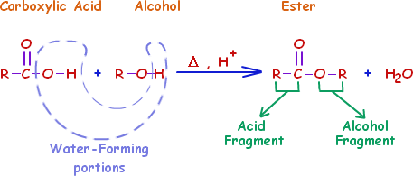

## Reaction with Carboxylic Acids

<table>
<thead>
<tr class="header">
<th><strong>Reagent</strong></th>
<th><strong>Condition</strong></th>
<th><strong>Type of Reaction</strong></th>
</tr>
</thead>
<tbody>
<tr class="odd">
<td>R-COOH</td>
<td>
Heat-reflux

Conc. H2SO4
</td>
<td>Esterification</td>
</tr>
</tbody>
</table> as fats, oils & flavours in fruits

  - Used in food flavourings and perfumes and as solvents
