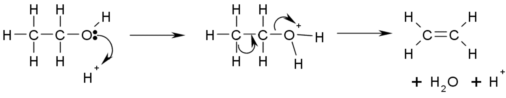

## Dehydration of Alcohols 

  - **Alcohol(l)** **Alkene + H2O(l)**
    
      - **Condition:**
        
          - Conc. H2SO4 OR
        
          - H3PO4 at 180oC OR
        
          - Al2O3 at 300oC
    
      - **Type of reaction:** Elimination

**Mechanism:**

  - Adjacent carbon to carbon with OH must have at least one hydrogen
    (tertiary cannot undergo dehydration)
