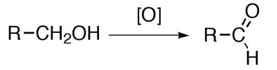
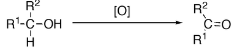

## Oxidation of Alcohols

* **Primary alcohols** can be oxidised into aldehydes, which can subsequently undergo further oxidation to yield carboxylic acids.
* **Secondary alcohols** can be oxidised to form ketones only.
* The oxidising agents of alcohols include acidified potassium dichromate ($K_2Cr_2O_7$) or acidified potassium permanganate ($KMnO_4$).

| Reagent | Observation | 
| -------- | -------- | 
| Acidified $K_2Cr_2O_7$ | **Orange** to **Green**| 
| Acidified $KMnO_4$| **Purple** to **Colourless**| 

* **Tertiary alcohols** not oxidised because no hydrogens attached to
  carbon with OH group so oxidising agent colour does not change.

Oxidation of primary alcohols

Oxidation of secondary alcohols

