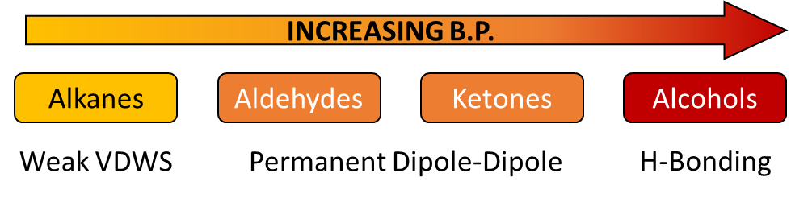

# Carbonyl Compounds

## Introduction

**Boiling Point:**

 

**Solubility:**

* **Smaller carbonyl compounds:** completely soluble as they form
  hydrogen bonds with water molecules; are good solvents for polar &
  non-polar solutes
* **Larger carbonyl compounds:** polar nature decreases, and non-polar nature increases, ability to form hydrogen bonds decreases

