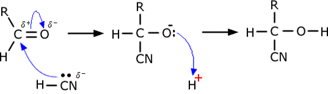

## Nucleophilic Addition with HCN

| **Reagent** | **Condition** | **Type of Reaction** |
|----|----|----|
| HCN | HCN w/alkali or HCN w/KCN | Nucleophilic Addition |

* Since HCN was added, the carbon chain increases
* The product formed is hydroxynitrile or cyanohydrine
* Aldehydes are more susceptible to nucleophilic attacks than ketones
* More minor carbonyl compounds are more reactive
* Product has a chiral carbon $\therefore$ exhibits optical
  isomerism

**Mechanism:**

 

* **Note:** HCN is a poor nucleophile with few CN- Ions, the reaction is slow. To increase CN- conc.:

<!-- end list -->

* Make HCN react in the presence of alkali

HCN + OH- H2O + CN-

* Addition of KCN and dilute H2SO4 can provide
  HCN and more CN- ions

