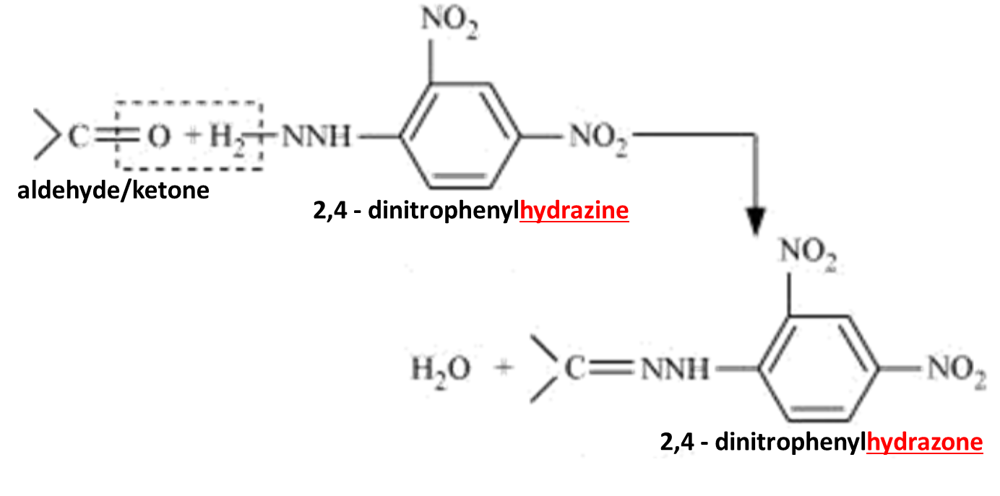

## Testing Carbonyl Compounds

**2,4,-dinitrophenylhydrazine:**

* It is a nucleophilic addition & condensation/elimination.
* Forms: **red/orange ppt.**
* The m.p. of the ppt. can be used to identify individual aldehydes
  and ketones

**Tests Given only by Aldehydes:**

* **Tollen’s Reagent**

<!-- end list -->

* Solution of $Ag(NO_3)_2$ +  $NH_3$ excess

* **Aldehyde + Tollens agent Silver Mirror**
* $Ag^+$ reduced to $ Ag$, and $–CHO$ oxidized to the acid

<!-- end list -->

* $2Ag^+ + RCHO 2 =>Ag + RCOOH^- + H^+$

<!-- end list -->

* **Fehling’s Solution**
  * $CuSO_4$ in ammonia solution
  * **Aldehyde + Fehling’s Solution** **Red ppt.**
  * $Cu_2+$ reduced to $Cu_{(I)}$ oxide and $–CHO$ oxidized to acid.
  * $2Cu_2+ + RCHO => 2Cu^+> + RCOOH^-$

