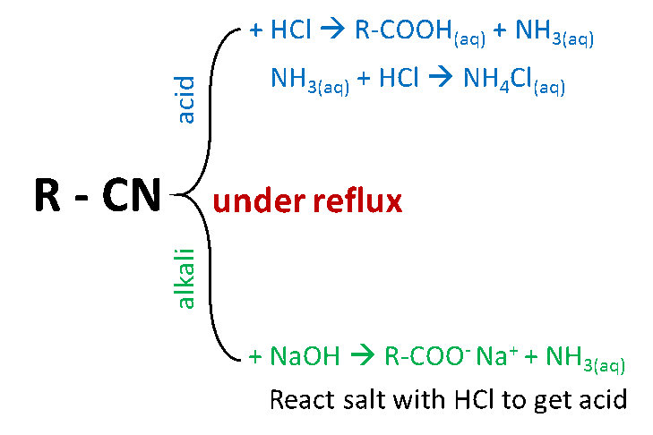

## Formation of Carboxylic Acids 

  - **From alcohols:** complete oxidation of primary alcohols

  - **From aldehydes:** oxidation of aldehydes

  - **From nitriles:** acid/base hydrolysis of a nitrile

