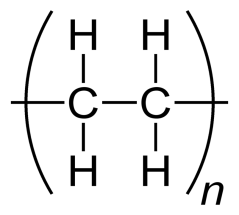
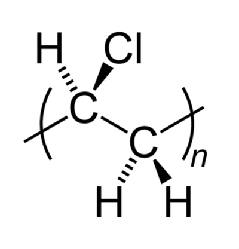

# Polymerisation

## Addition Polymerisation

* Monomers are alkenes; the polymer formed is polyalkene
* Alkene joins to itself, and no molecule is lost

  E.g. $\text{nA}\rightarrow \ \  - A - A - A - A -$ or ­$( - A - )_n$
* The molecular mass of the polymer is multiple monomers

**Physical Properties of Polymers:**

* Only C and H present = only VDW forces present
* Presence of Cl or F = dipoles = permanent dipole interaction
* Longer chains with fewer side chains have stronger VDW forces

<table> <thead> <tr> <th>‎</th> <th>‎</th> </tr> </thead> <tbody> <tr> <td>polyethene</td> <td>polytetrafluoroethene</td> </tr> </tbody> </table>

|   |
|----|
| Poly Vinyl Chloride (poly-chloroethene) |

| LDPE | HDPE |
|----|----|
| Soft plastic made with non-polar polymer | Using Ziegler catalyst |
| Highly branched chains | Hard plastic made with non-polar polymer |
| Low melting point | Unbranched chains |
| Chains cannot pack closely due to random branching, leaving gaps | High melting point |
| Low density | Closely packed chains, fewer gaps |
|    | High density |

