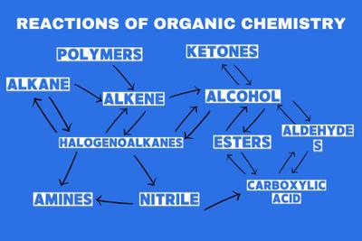

## Things to Remember

* Reactants and products
* Reaction Mechanisms
  * Electrophilic Addition
  * Nucleophilic Substitution
  * Free Radical Substitution
  * Nucleophilic Addition
* **Conditions for reactions like**
  * Organic Compounds like ethanol
  * Heat under Reflux
  * Pressure/Closed Container
  * Catalyst like $NaBH_4$, acids

 