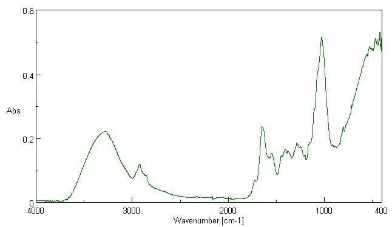

# Analytical Techniques

## Infra-red Spectroscopy

* This is when a sample being analysed is irradiated with
  electromagnetic waves in the infra-red region of the electromagnetic
  spectrum.
* The machine used is a spectrophotometer, and it detects the intensity of wavelengths of infra-red that pass through the sample
* The energy absorbed corresponds to changes in the vibration of bonds, leading to the bond being stretched, bend and twist
* At a specific frequency, the **resonance frequency,** the largest
  vibrations are obtained
* Each type of vibration will absorb characteristic wavelengths of
  infra-red radiation
* We can hence identify the presence (or absence) of different
  functional groups from the absorbance pattern on an infra-red
  spectrum

