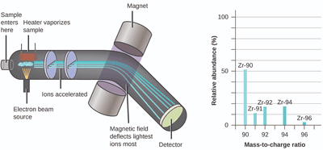

## Mass Spectrometry

Introduction

* Chemical substances are identified by their mass-to-charge ratio.
* The substance is ionized and given charge.
* The charged ions pass through magnetic and electric fields to calculate the mass-to-charge ratio of each ion present.

  \
   
* The abundance of the ions is used to identify different elements and functional groups of a compound.

