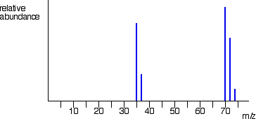

## Isotopic Abundance of Elements

* Identifies the relative abundances of different isotopes in a sample.

 

* The 2 left most peaks represent the 2 isotopes of Chlorine i.e., Cl-35 and Cl-37.
* The right-most 3 peaks represent the Chlorine molecules with different arrangements with Cl-35 and Cl-37.
* The ratio between the Cl-35 and Cl-37 peaks represents the relative abundance of the isotopes.

