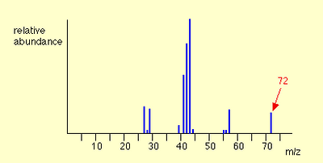

## Organic Fragment Pattern

* Alkyls like $CH_3$- form Fragment patterns on Mass Spectrometer
* We can use the Molecular ion peak ( $M_+$ ) as identified here

   
* Here, 72 is the Molecular ion peak.
* It is the total mass of the organic molecule.
* Used to identify Carbon atoms present in the Compound using formula.

  $$
  n \ (Number \ of \ Carbon \ atoms)=\frac{100 * M_ {+1}}{1.1 * M_+} 
  $$
* $M_{+1}$ Represents the abundance of peak to the right of molecular ion peak.
* It is smaller than the $M_+$ peak and caused by the C-13 isotope.
* 1 in every 100 Carbon is C-13, so it has a ratio of $M_+$  depending on the number of carbon atoms.
* Different atoms and functional groups create several peaks that the table can identify.

