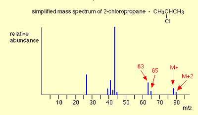
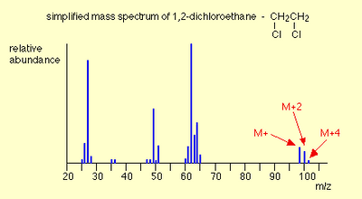
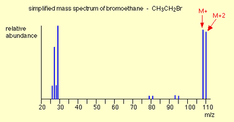

## Halogen Identification

* Uses $M_{+2}$ peak to identify Chlorine and Bromine atoms in the organic compound.

### **For 1 Chlorine:** 

* $M_{+2}$ is in 3:1 to $M_{+}$
* Both have a difference of 2 m/z due to the isotopes of Chlorine.
* If the conditions are met, there is a Chlorine atom.

### **For 2 Chlorine:**

 

* There are $M_{+2}$ and $M_{+4}$ peaks alongside $M_{+}$ peak.
* They have a difference of 2 m/z.
* $M_{+4}$, $M_{+2}$, $M_{+}$ are in the ratio 9:6:1.
* If the conditions are met, there are 2 Chlorine atoms.

### **For Bromine:**

 

* There are $M_{+2}$ peaks alongside $M_{+}$ peak.
* They have a difference of 2 m/z.
* $M_{+2}$, $M_{+}$ have almost same height.
* If the conditions are met, there is a Bromine atom.

