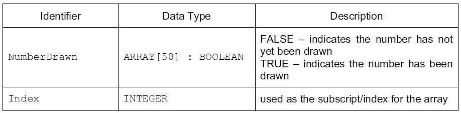

## Identifier Table

  - **Identifier:** name given to a variable in order to call it

  - An identifier table depicts information about the variable, e.g.

  - **Rules for naming identifiers:**
    
      - Must be unique
    
      - Spaces must not be used
    
      - Must begin with a letter of the alphabet
    
      - Consist only of a mixture of letters and digits and the
        underscore character ‘\_’
    
      - Must not be a ‘reserved’ word – e.g. Print, If, etc.