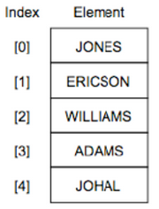
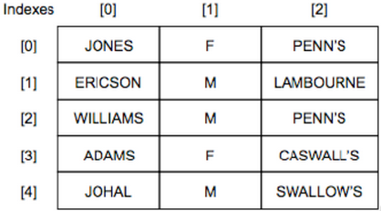

## Arrays

* **1-Dimensional (1D) Array:** declared using a single index, can be represented as a list

 

* **2-Dimensional (2D) Array:** declared using two indices, can be
  represented as a table

 

* **Pseudocode:**
  * 1-D Array: `array = []`
  * 2-D Array: `array = [[], [], [], …]`
* **Python:**
  * Declaring an array: `names = []`
  * Adding to an array: `names.append(‘ZNotes’)`
  * Length of array, i.e. number of elements: `len(names)`
  * Printing an element in a 1D array: `print(names[element position])`
  * Printing element in a 2D array: `print (a[row][column])`
  * Printing row in a 2D array: `names[row] = [new row]`
  * Printing column: Use it for loop, add 1 to the row, and keep the column the same.

