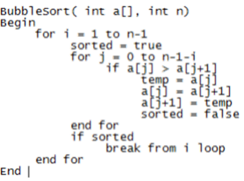

## Bubble Sort

  - A FOR loop is set to stop the sort

  - Setting a variable ‘sorted’ to be ‘true’ at the beginning

  - Another FOR loop is set up next in order to search through the array

  - An IF is used to see if the first number of the array is greater
    than the second. If true:
    
      - First number stored to variable
    
      - Second number assigned as first number
    
      - Stored variable assigned to second number
    
      - Set ‘sorted’ to ‘false’ causing loop to start again

  - The second FOR loop is count based thus will stop after a specific
    number of times

  - Goes through bigger FOR loop $\therefore$ ‘sorted’ remains ‘true’

  - This exits the loop $\therefore$ ending the program
