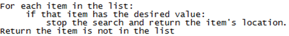

## Linear Search

  - A FOR loop goes through the array

  - It compares item in question to those in list using an IF:
    
      - If item matches with another then search is stopped
    
      - Also the location where it was found is returned
    
      - If not found it exits the FOR loop

  - Then returns fact that item in question is not in the list
