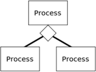
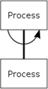
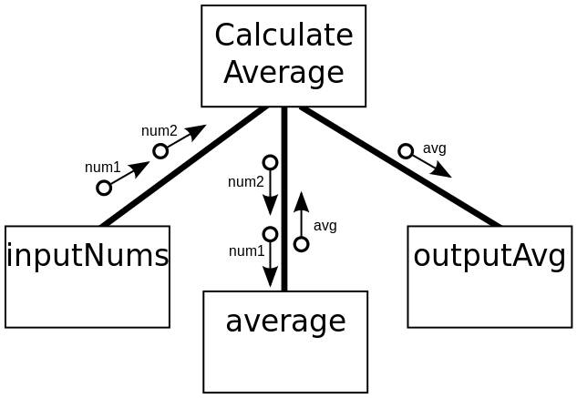

## Structure Charts

  - **Purpose:** used in structured programming to arrange program
    modules, each module represented by a box

  - Tree structure visualizes relationships between modules, showing
    data transfer between modules using arrows.

  - Example of a top-down design where a problem (program) is broken
    into its components.

**Rules:**

  - **Process:** Represents a programming module e.g. a calculation

  - **Data couple:** Data being passed from module to module that needs
    to be processed

  - **Flag:** Check data sent to start or stop a process. E.g. check if
    data sent in the correct format

  - **Selection:** Condition will be checked and depending on the
    result, different modules will be executed

  - **Iteration:** Implies that module is executed multiple times

**Example:**

