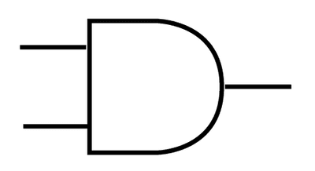
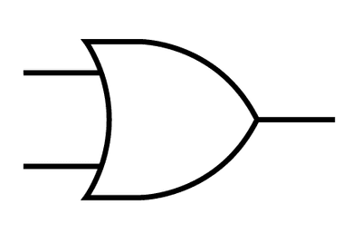
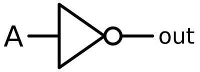
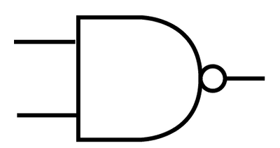
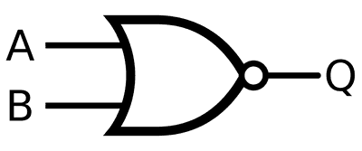
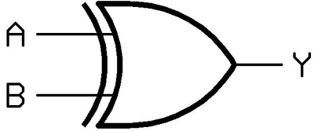

## Logic Gates and Logic Circuits

* **Logic Gates:** use one or more inputs and produce a single logical output
* **AND gate: If both inputs are high, the output is high (*A•B*)**

|**A**|**B**|**Output**|
|:---|:---|:---|
|**0**|**0**|**0**|
|**0**|**1**|**0**|
|**1**|**0**|**0**|
|**1**|**1**|**1**|

* OR gate: If either input is high, the output is high (*A+B*)

|A|B|Output|
|:---|:---|:---|
|0|0|0|
|0|1|1|
|1|0|1|
|1|1|1|

* NOT gate: an inverter (A)

|A|Output|
|:---|:---|
|1|0|
|0|1|

* NAND gate: (A•B)

|A|B|Output|
|:---|:---|:---|
|0|0|1|
|0|1|1|
|1|0|1|
|1|1|0|

 

* NOR gate: (A+B)  

|A|B|Output|
|:---|:---|:---|
|0|0|1|
|0|1|0|
|1|0|0|
|1|1|0|

 

* XOR gate: (*A*⨁*B*) 

|A|B|Output|
|:---|:---|:---|
|0|0|0|
|0|1|1|
|1|0|1|
|1|1|0|

  