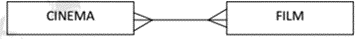
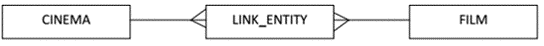

## Normalization

**1st Normal Form (1NF):** contains no repeating attribute or
groups of attributes. Intersection of each tuple and attribute contains
only 1 value. Example:

 

**2nd Normal Form (2NF):** it is in 1NF and every non-primary
key attribute is fully dependent on the primary; all the incomplete
dependencies have been removed. Example:

 

**3rd** **Normal Form (3NF):** it is in 1NF and 2NF and all
non-key elements are fully dependent on the primary key. No
inter-dependencies between attributes.

* MANY-TO-MANY functions cannot be directly normalized to 3NF, must
  use a 2 step process e.g.

 

becomes:

 