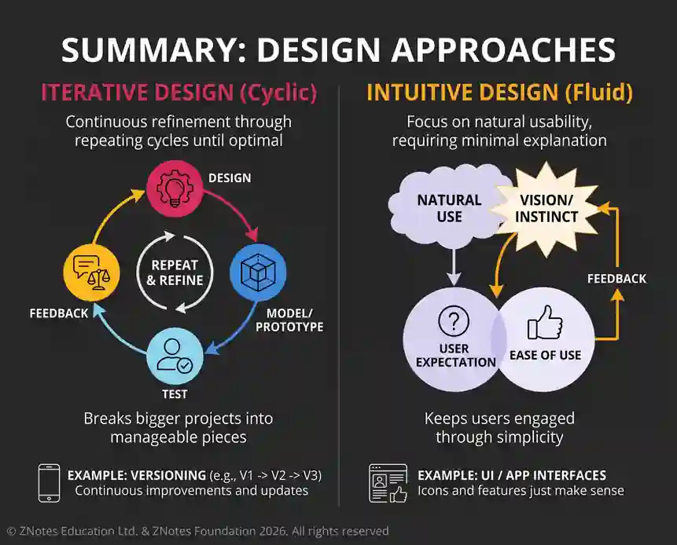

# The Design Process

## Approaches to Designing

### Iterative Design

* **Iterative design** is a user-centric approach focused on creating products and interfaces with a natural sense of ease, familiarity, and high usability.

* Projects are broken into smaller, manageable pieces that are continuously evaluated and modified rather than delivering a single finished design at once.

* In practice, consumer electronics (such as smartphones), hardware, and software are continuously refined across generations based on user feedback and technological advancements.

### Intuitive Design

* **Intuitive design** is a user-centric approach that aims to build products and interfaces with a natural sense of ease and usability.
* It minimises cognitive load so users do not require complex instructions.
* Mobile apps like WhatsApp and Instagram use universally recognized icons and gestures, keeping users engaged through effortless navigation.
* This, among other factors, contributes to user retention as users don’t struggle using the product.
* 