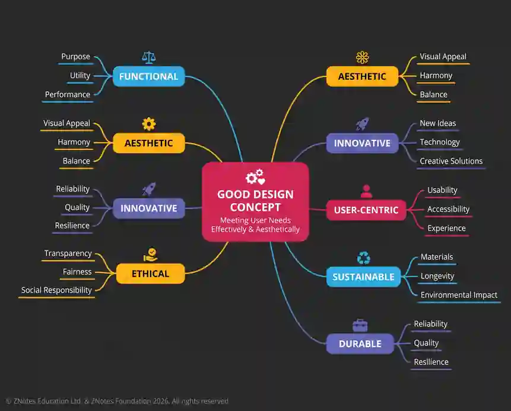

## Stages in the design process

Designing and realizing a product follows a structured, sequential workflow from initial need to final evaluation:

 1. **Identifying an original design need or product improvement:** Recognizing a gap in the market or analyzing how an existing commercial product can be enhanced.

 2. **Preparing a design brief:** Writing a concise statement outlining the core design requirements and parameters.

 3. **Information gathering and analysis:** Finding and collating technical, contextual, and market data relevant to the design need.

 4. **Conducting primary and secondary research:** Using market research tools such as observations, user interviews, questionnaires, and literature reviews.

 5. **Drawing up a design specification:** Establishing a comprehensive list of succinct, justified, and measurable requirements (covering human, aesthetic, technical, and environmental factors).

 6. **Generating and recording possible solutions:** Using freehand sketching and annotation to explore diverse conceptual ideas.

 7. **Developing and refining ideas:** Using further research and analysis to screen and mature ideas against the design specification.

 8. **Evaluating and selecting solutions:** Comparing alternative solutions using structured techniques and selecting one optimal design for development.

 9. **Modelling aspects of ideas:** Constructing scaled models or prototypes to test aesthetic appearance, ergonomics, and structural viability.

10. **Developing a detailed design proposal:** Producing clear working drawings (orthographic, isometric, assembly, or CAD models) with sufficient detail for manufacture.

11. **Identifying required resources:** Listing all necessary materials, components, tools, and equipment.

12. **Organising resources:** Scheduling and staging resources efficiently prior to realisation.

13. **Planning for efficient production:** Planning the economical and sustainable use of materials, energy, and time.

14. **Realising the product:** Manufacturing the product or prototype using appropriate tools, equipment, and processes.

15. **Applying health and safety procedures:** Adhering strictly to workshop safety protocols, risk assessments, and PPE requirements.

16. **Testing product success:** Conducting rigorous functional, structural, and user-trial tests against the original specification.

17. **Proposing further improvements:** Reviewing test data and user feedback to suggest future design modifications or scale-up considerations.

