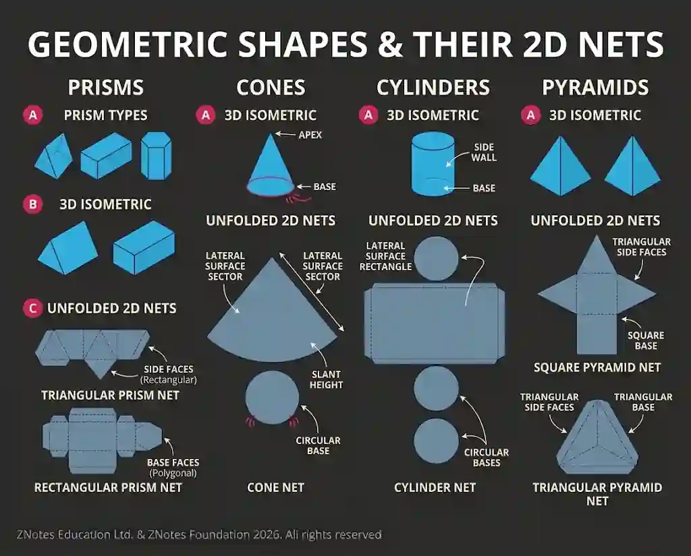

## Developments (nets)

* A development, or net, is a flat two-dimensional shape that can be folded to create a three-dimensional object. Understanding nets is essential for designing and manufacturing packaging, models, and 3D items, including prisms, cones, cylinders, and pyramids.

* **Glue Tabs -** These are extended flaps along the edges of a net that are coated with adhesives, such as PVA, contact adhesive, or double-sided tape, to permanently join seams together during assembly.

* **Mechanical Joining Methods -** These incorporate locking tabs, slots, folding flaps, and interlocking mechanisms built directly into the net design. They allow structures to be held securely together without the need for chemical adhesives, which is widely used in flat-pack cardboard engineering and packaging.