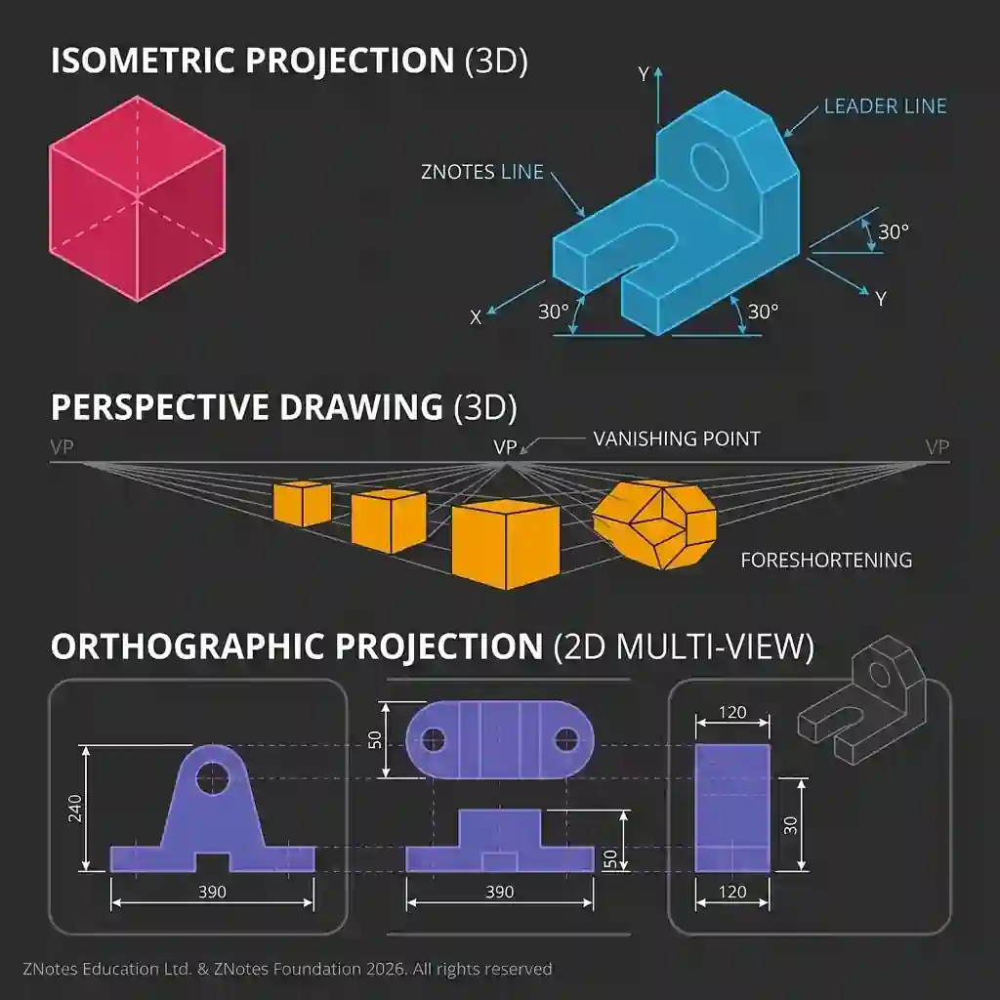

## **Orthographic Working Drawings**

* Orthographic projection displays a three-dimensional object in two dimensions through multiple multi-view orthogonal projections, indicated by a standard projection symbol.

* **First Angle Projection -** The object is viewed from behind the drawing planes, placing the top view below the front view and the right-hand view to the left. This method is common in Europe.

* **Third Angle Projection -** The projection planes are positioned between the viewer and the object, placing the top view above the front view and the right-hand view to the right. This method is common in the USA and Asia.

* **Scales -** These indicate the ratio of drawing size to real-life size. Examples include reduction scales (e.g., 1:50 for large items), full-size scales (1:1 for exact sizing), and enlargement scales (e.g., 5:1 for small components).

* **Dimensioning -** All measurements are provided in millimetres (mm) using thin lines and arrowheads. Repetition of dimensions is strictly avoided.

* **BS 8888 Standards -** These standards ensure consistency in engineering drawings. They specify line types, thick lines for visible edges, dashed lines for hidden details, and chain lines for centerlines, as well as structured title blocks containing drawing names, scales, and projection information.

* **Part Drawings -** These contain all necessary information to manufacture a single component, including exact dimensions, tolerances, material types, and surface finishes.

* **Sectional Views -** These display internal features as if the object has been cut open, reducing the need for complex hidden lines. Cut areas are indicated using specific hatching lines.