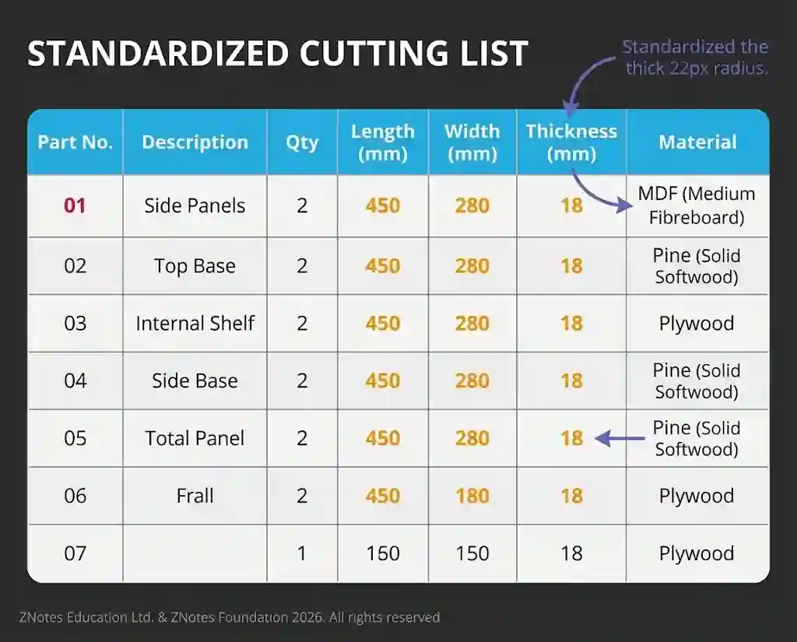

## Planning drawings

### **Flowcharts**

* Diagrams that outline the sequence of steps and decisions in a process using standardized symbols. They clarify process logic and system workflows

### Gantt Charts

* Bar charts that display project schedules by mapping out the start and finish dates of individual activities. They assist in tracking progress and identifying task dependencies for project management.

### Materials or Cutting Lists

* A materials list (Bill of Materials or BOM) details all raw materials, components, and sub-assemblies needed to build a product to help calculate costs. A cutting list specifies exact sizes and quantities to be cut from stock material to minimize waste.