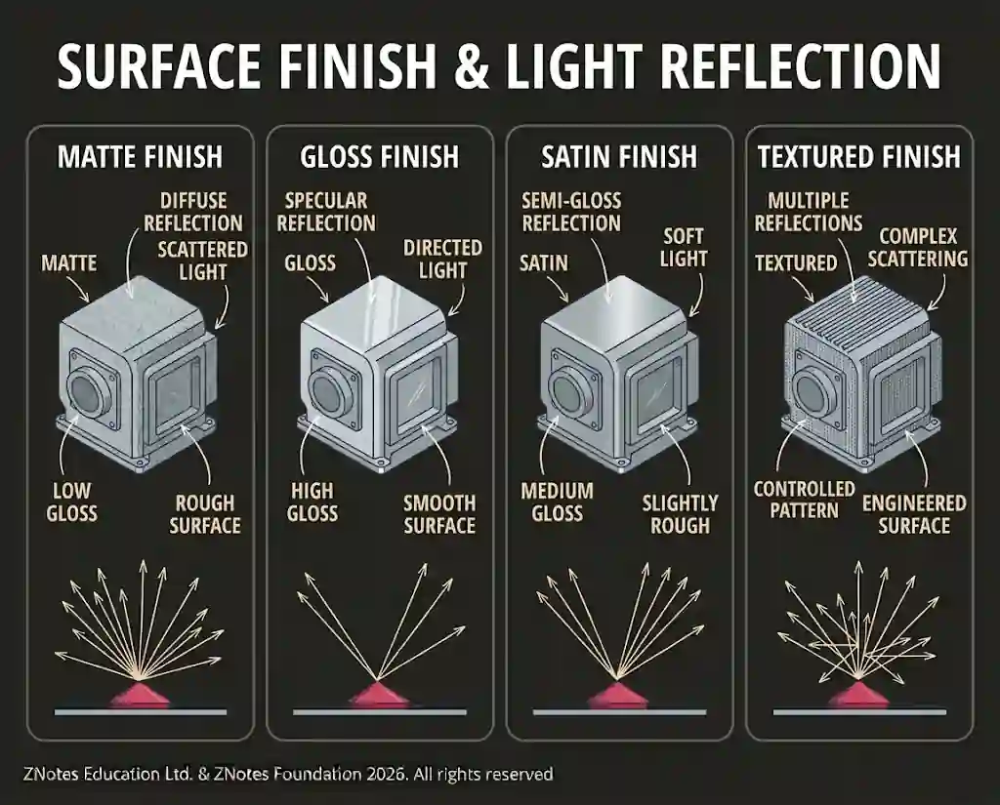

# Aesthetics and Ergonomics

## Aesthetics

* Aesthetics is the area of design concerned with the visual appearance and sensory qualities of a product.

* It's about how a product looks, feels, and sounds.

* Key elements include

  * **Line -** Guides the user's eye, establishes visual boundaries, and creates a sense of dynamic direction or structural stability.

  * **Colour -** Evokes specific psychological responses, creates visual contrast, organizes complex interfaces, and establishes product branding.

  * **Shape -** Defines the two-dimensional external contour of a product; geometric shapes communicate precision and rigidity, while organic curves feel approachable and friendly.

  * Proportion refers to the relative size of different parts; the Apple iPhone Pro devices have camera bump sizes that balance the slim body and make holding it comfortable.

  * Form is the three-dimensional shape of a product. Cars are usually curvier if they are fast sports cars, as this can communicate speed and style.

* The way light reflects off a surface creates highlights and shadows, giving a product depth and form; smooth, glossy surfaces reflect sharp highlights denoting sleekness, whereas matte textures diffuse light softly to create a subdued, premium feel.

* Different surface finishes affect both visual and tactile senses: visual textures can make a flat material look rich, while tactile senses are engaged through physical textures (such as knurled grips, soft-touch rubber, or warm wood grains) that enhance grip security, comfort, and skin feel.

* **Balance of form and function -** A distinct design principle ensuring that a product's aesthetic appearance (form) does not compromise its operational utility (function), and vice versa. An ideal design harmonizes both so that the visual styling naturally reinforces how the product works rather than hindering it.