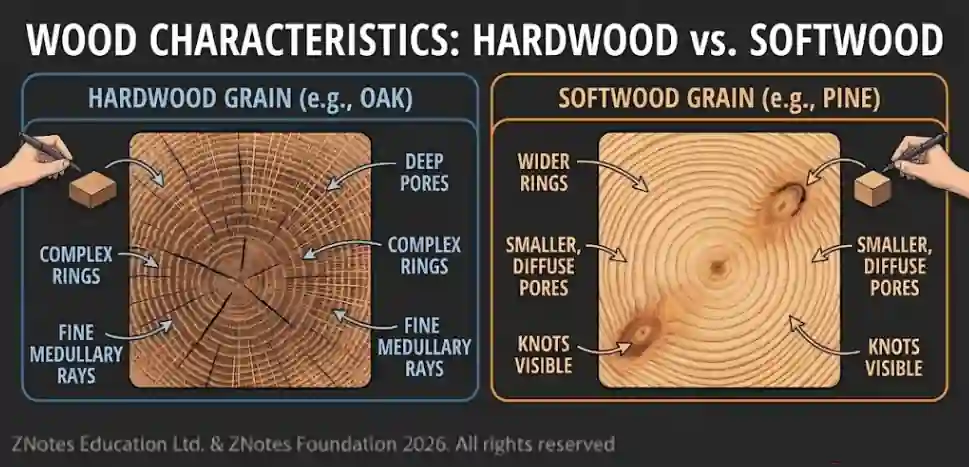

## Woods

* Woods are materials that are derived from trees.

#|
||

Softwood

|

Working Properties

|

Common Uses

|

Environmental Impact

|

Stock Forms

||
||

Pine

|

Pine is a very workable softwood. It's easy to cut, shape, and finish with both hand and power tools. It has a uniform, straight grain, which makes it less likely to split when nailed or screwed. However, it can have knots that make some areas harder to work with.

|

Due to its affordability and workability, pine is widely used for general construction, furniture, interior joinery (e.g., skirting boards, door frames), and crates.

|

Pine is a fast-growing tree, making it a very sustainable and renewable resource. Many pine forests are managed sustainably, with replanting programs to replace harvested trees.

|

Boards, planks, square sections, dowels, and sheets. It's also a major source for manufactured boards like plywood and MDF.

||
||

Fir

|

Fir is strong and has excellent dimensional stability, meaning it holds its shape well. It's lightweight, easy to work with, and has a straight, fine grain. It can be susceptible to rot if not treated, and its resin content can make it challenging to finish smoothly.

|

Fir is a popular choice for structural framing in residential and commercial construction (e.g., floor joists, wall studs). It's also used for doors, windows, millwork, and plywood.

|

Similar to other softwoods, fir is a renewable resource. The environmental impact is largely dependent on the forestry practices used to harvest the trees.

|

Boards, planks, and larger dimensional lumber for construction.

||
||

Spruce

|

Spruce is known for its high strength-to-weight ratio, making it strong yet light. It has a light color, a fine grain, and a uniform texture. It's very easy to work with, glue, and finish.

|

Due to its excellent acoustic properties, spruce is the primary wood used for soundboards in musical instruments like pianos, violins, and guitars. It's also used extensively for general construction, paper production, and as Christmas trees.

|

Spruce is a sustainable and renewable resource often harvested from responsibly managed plantations. However, monoculture spruce plantations can reduce local plant diversity.

|

Boards, planks, and special sections for musical instruments.

||
||

Cedar

|

Cedar is valued for its natural resistance to decay and insects, which comes from its aromatic oils (thujaplicins). It's very lightweight, easy to work with, and dimensionally stable, meaning it won't warp or shrink much with changes in humidity.

|

The durability and weather resistance of cedar make it ideal for outdoor applications like decking, fencing, siding, and roofing shingles. It's also used for chests and closet linings to deter moths.

|

Cedar is a sustainable and renewable resource. It's a great environmentally friendly option because it naturally lasts for a long time, reducing the need for chemical treatments or frequent replacement.

|

Boards, planks, shakes, and shingles.

||
|#

#|
||

Hardwood

|

Working Properties

|

Common Uses

|

Environmental Impact

|

Stock Forms

||
||

Mahogany

|

Mahogany is a beautiful, reddish-brown wood with a fine, straight grain. It is valued for its exceptional workability—it cuts, shapes, and sands easily. It is also dimensionally stable, meaning it resists warping and swelling with changes in humidity.

|

Due to its beauty and durability, mahogany is a traditional choice for high-end furniture, cabinetry, musical instruments (especially guitars), and boat building.

|

Many species of mahogany are endangered due to illegal logging and unsustainable harvesting, which has a significant negative environmental impact. It is crucial to source mahogany from sustainably managed forests certified by organizations like the Forest Stewardship Council (FSC).

|

Boards, planks, and veneer sheets.

||
||

Teak

|

Teak is known for its incredible durability and natural weather resistance. It contains high levels of natural oils, which make it highly resistant to rot, pests, and moisture without the need for chemical treatment. However, its high oil content can make it difficult to glue or finish without proper preparation.

|

Its resilience to outdoor elements makes it the premier choice for outdoor furniture, boat decking, and other marine applications. It's also used for indoor furniture, flooring, and decorative items.

|

Similar to mahogany, high demand for teak has led to over-harvesting and deforestation. Sourcing from certified plantations is essential for ethical consumption.

|

Boards, planks, and decking.

||
||

Beech

|

Beech is a very hard, heavy, and strong wood with a fine, uniform grain. It has excellent bending properties, particularly after being steam-bent. It is not as naturally durable as other hardwoods and can be susceptible to moisture damage.

|

Its ability to bend makes it ideal for curved furniture components, such as chair legs and backs. It is also used for kitchen utensils, tool handles, and flooring.

|

Beech is often more sustainable than exotic hardwoods as it is a fast-growing species found in temperate regions, making it a locally-sourced option in many parts of the world.

|

Boards, planks, and dowels.

||
||

Ash

|

Ash is a tough, durable wood with excellent shock resistance and flexibility. It has a light color and a coarse, attractive grain. It's easy to work with and takes finishes well.

|

Its shock-absorbing qualities make it perfect for sports equipment like baseball bats, hockey sticks, and tool handles. It's also used for furniture, flooring, and veneers.

|

The North American ash population has been devastated by the Emerald Ash Borer insect. This has made the sourcing of new ash timber more difficult, but it has also led to an environmentally friendly practice of reclaiming lumber from dead trees.

|

Boards, planks, and veneers.

||
||

Oak

|

Oak is a very dense, hard, and durable wood with a distinctive open grain. It is strong and resistant to moisture and rot, especially the white oak species. It can be difficult to work with hand tools due to its hardness and density.

|

Oak has a long history of use for high-quality furniture, flooring, cabinetry, and interior trim. Its durability makes it a classic choice for a variety of long-lasting products.

|

Oak is generally considered a sustainable choice as it is widely available and grows in responsibly managed forests in many regions. Its longevity means oak products have a long life, reducing waste.

|

Boards, planks, veneers, and sheets.

||
|#

