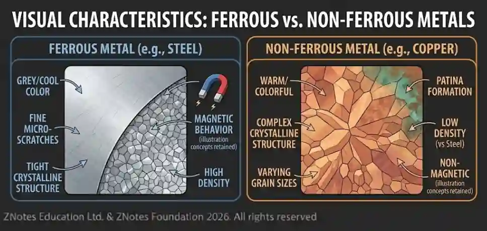

## Metals

#|
||

Ferrous Metal

|

Working Properties

|

Common Uses

|

Environmental Impact

|

Stock Forms

||
||

Cast Iron

|

Cast iron is very hard and brittle, with excellent compressive strength, but poor tensile strength. It has a high carbon content (2-5%) and a low melting point, making it ideal for casting into complex shapes. It cannot be forged or bent without breaking.

|

Cast iron is used for machinery bases, engine blocks, manhole covers, frying pans, and decorative railings.

|

Cast iron is a highly durable and long-lasting material. It is also 100% recyclable and can be melted down and reused indefinitely without loss of quality.

|

Ingots, sand castings, and pre-formed components.

||
||

Mild Steel

|

Mild steel (or low-carbon steel) is the most common and versatile type of steel. It has high tensile and impact strength, but is also malleable and ductile, making it easy to cut, form, and weld. Its main drawback is that it rusts easily when exposed to moisture.

|

It is used extensively in construction for girders and structural components, as well as for car bodies, pipes, wire, and fencing.

|

Mild steel is the most recycled material in the world. Its production requires less energy than other steels, and its high rate of recycling significantly reduces the need for new raw materials.

|

Sheets, plates, rods, bars, angles, and tubes.

||
||

Stainless Steel

|

Stainless steel is an alloy of steel that contains a minimum of 10.5% chromium. This chromium creates a thin, passive oxide layer on the surface that makes it highly resistant to rust and corrosion, even in harsh environments. It is strong, durable, and hygienic, but can be more difficult to work with than mild steel.

|

Kitchen sinks, cutlery, surgical instruments, food processing equipment, and architectural cladding.

|

Stainless steel is 100% recyclable, and more than half of new stainless steel is made from recycled scrap. The longevity of stainless steel products also reduces waste.

|

Sheets, coils, plates, rods, and tubes.

||
||

High Speed Steel

|

HSS is a tool steel known for its exceptional hardness, wear resistance, and ability to maintain its hardness at high temperatures (red hardness). This makes it perfect for tools that generate a lot of heat when cutting. It is very brittle.

|

Cutting tools such as drill bits, milling cutters, taps, and saw blades.

|

The production of HSS is energy-intensive and involves mining for alloying elements like tungsten and molybdenum, which can have significant environmental impacts. However, its long lifespan and recyclability can help to mitigate this.

|

Tool bits, bars, and rods.

||
||

Carbon Steels

|

Carbon steels are alloys of iron and carbon. Their properties vary widely depending on the carbon content. Low-carbon steels are soft and ductile, while high-carbon steels are much harder, stronger, and more brittle, making them excellent for cutting tools.

|

Low-carbon steels are used for general-purpose wires, nails, and structural shapes. High-carbon steels are used for springs, saws, knives, and other cutting tools that require a sharp edge.

|

The environmental impact of carbon steels is directly related to the energy consumed in their production and their recyclability. The steel industry as a whole is a major contributor to CO₂ emissions. However, steel's high recyclability rate is a key factor in improving its overall sustainability

|

Sheets, plates, bars, wires, and rods.

||
|#

#|
||

Non-ferrous Metal

|

Working Properties

|

Common Uses

|

Environmental Impact

|

Stock Forms

||
||

Aluminium

|

Aluminium is known for being lightweight and having a high strength-to-weight ratio. It's soft and malleable in its pure form, but can be made stronger by alloying. It has excellent thermal and electrical conductivity and is highly corrosion resistant

|

used in aircraft and vehicle parts, beverage cans, window frames, and electrical transmission lines

|

Primary production of aluminium is very energy-intensive. However, it's infinitely recyclable, and recycling it uses significantly less energy (about 95% less) than producing it from raw bauxite ore

|

Sheets, plates, rods, bars, and extrusions

||
||

Copper

|

Copper is a reddish-brown, soft, malleable, and ductile metal. It has excellent electrical and thermal conductivity, second only to silver. It's also highly corrosion-resistant

|

Its high conductivity makes it essential for electrical wiring, cables, and circuit boards. It's also used for plumbing pipes, roofing, and heat exchangers

|

Mining for copper can have significant environmental consequences, including habitat destruction and the release of toxic substances. However, copper is highly recyclable and can be reused indefinitely without losing its properties.

|

Wires, tubes, sheets, and plates

||
||

Lead

|

Lead is an extremely dense, soft, and malleable metal with a low melting point. It's easy to cut and form. Its density makes it an effective shield against radiation

|

lead-acid batteries, X-ray and gamma radiation shielding, roofing, and soundproofing materials.

|

Lead is a heavy metal and is highly toxic to humans and the environment. It is a persistent environmental pollutant and can accumulate in soil and water. Proper disposal and recycling are crucial to prevent environmental contamination

|

Sheets, pipes, and blocks

||
||

Tin

|

Tin is a soft, silvery-white, and malleable metal with a low melting point. It's highly resistant to corrosion

|

Primarily used as a protective coating for other metals (tin-plating on steel to make "tin" cans) and as a key component in solder for joining electrical components. It's also a major component in alloys like bronze and pewter.

|

Tin mining can cause environmental damage. However, its low melting point and recyclability help reduce its overall environmental footprint

|

Ingots, bars, and wire

||
||

Zinc

|

Zinc is a medium-strength, brittle metal with a relatively low melting point. It's known for its excellent corrosion resistance

|

Its primary use is in galvanizing, coating steel to prevent it from rusting. It's also a crucial component of alloys like brass (copper and zinc), and is used in batteries.

|

Zinc mining can be environmentally damaging. While zinc can be recycled, the galvanizing process itself creates waste that must be managed to prevent environmental pollution

|

Sheets, plates, and ingots

||
||

Titanium

|

Titanium is renowned for its exceptional strength-to-weight ratio and its incredible resistance to corrosion, even in seawater and chlorine. It has a high melting point and is biocompatible. It can be difficult to machine due to its high strength

|

Aerospace components (jet engines, airframes), medical implants (pacemakers, artificial joints), and high-end sporting goods (golf clubs, bicycle frames)

|

The extraction and processing of titanium are very energy-intensive and can have a significant environmental impact. However, its long service life and durability reduce the need for replacement, which can offset some of its production-related environmental costs

|

Sheets, plates, bars, and wire

||
||

Tungsten

|

tungsten has the highest melting point and highest tensile strength of any pure metal. It is extremely hard and dense, and has low thermal expansion. It is very brittle and difficult to work with.

|

Due to its hardness and high melting point, it's used in high-speed steel for cutting tools, filaments for incandescent light bulbs, and components in the aerospace industry.

|

The mining and processing of tungsten can be environmentally harmful. However, its longevity and high recyclability rate are positive factors.

|

Powders, bars, and wire.

||
||

Duralumin

|

Duralumin is an aluminium alloy that contains copper, magnesium, and manganese. It is known for its high strength and hardness, making it comparable to mild steel in strength while being much lighter. It can be heat-treated to further increase its strength

|

used in the aerospace industry for aircraft structures, including frames and rivets, due to its excellent strength-to-weight ratio. It's also used in other transportation applications.

|

As an aluminium alloy, its environmental impact is similar to that of pure aluminium, with energy-intensive primary production but high recyclability.

|

Sheets, plates, bars, and extrusions.

||
|#

