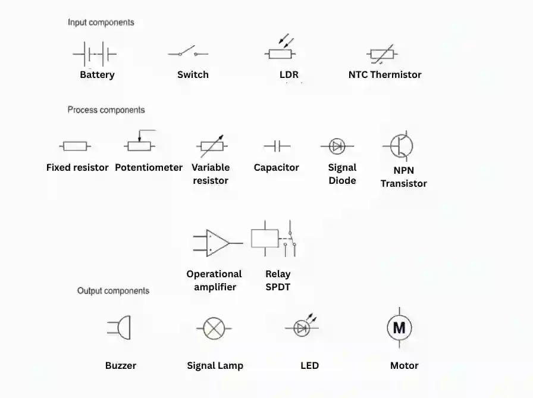

## Components

### Input Components

Input components detect physical environmental changes or user actions (like pressing a switch) and convert them into electrical signals.

* **Battery -** Provides the electrical power (DC voltage) required to drive the control circuit.

* **Switch (SPST) -** A manual input device that opens or closes a circuit to start or stop current flow.

* **LDR (Light Dependent Resistor) -** A light sensor whose resistance decreases as light intensity increases, used in automatic lighting control systems.

* **NTC Thermistor -** A temperature sensor whose resistance decreases as temperature rises, used in thermal control systems (e.g., thermostats).

### Process Components

Process components manipulate, adjust, amplify, or condition electrical signals received from inputs to make control decisions.

* **Fixed Resistor -** Limits current flow to protect sensitive components (such as LEDs) from damage.

* **Potentiometer / Variable Resistor -** Manually adjustable resistors used to alter sensitivity or set reference voltage levels in control circuits.

* **Capacitor -** Stores and releases electrical charge, commonly used for filtering or creating time-delay circuits.

* **Signal Diode -** Allows electric current to flow in only one direction, protecting circuits from reverse polarity or back-EMF.

* **NPN Transistor -** Acts as an electronic switch or signal amplifier, allowing a small input current to turn on a much larger output current.

* **Operational Amplifier (Op-Amp) -** A high-gain voltage amplifier used to compare input signals (e.g., comparing a sensor voltage against a reference voltage) to trigger an output.

* **Relay (SPDT) -** An electrically operated switch that uses an electromagnet to safely turn higher-voltage output circuits on or off using a low-power control signal.

### Output Components

Output components take processed electrical signals and convert them into physical actions, sound, or light.

* **Buzzer -** Converts electrical energy into audible sound signals for warnings or alarms.

* **Signal Lamp -** Converts electrical energy into visual light indicators.

* **LED (Light Emitting Diode) -** An energy-efficient visual output device that illuminates when current passes through it in the correct direction.

* **Motor -** Converts electrical energy into mechanical rotational movement to drive mechanisms.

## 