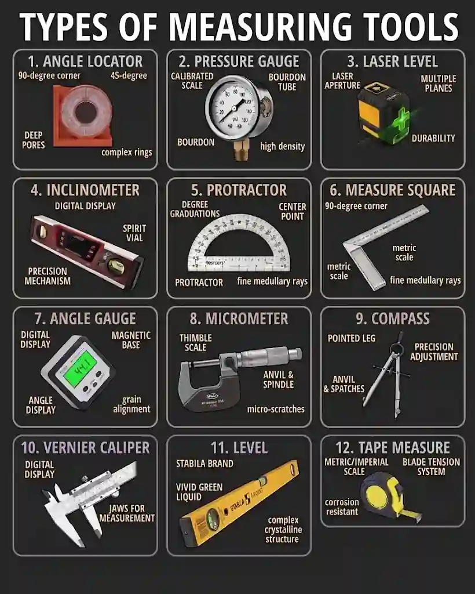

# **Stages in Materials Processing**

## Measuring and marking out from working drawings

* For Wood

  * Steel Rule or Tape Measure: Used to measure linear lengths directly transposed from dimensions specified in orthographic or assembly drawings.

  * Try Square: Placed flat against a prepared reference edge to check and scribe accurate 90-degree cross-lines derived from working drawing dimensions.

  * A Marking Gauge: Scribes a line parallel to a reference edge using a steel spur, ideal for marking out accurate widths for mortise and tenon joints specified in working drawings.

  * Pencil / Marking Knife: Used to transfer lines clearly without crushing wood fibres or compromising joint accuracy.

* For Metal

  * Steel Rule and Calipers: Used to measure and transfer precise internal/external dimensions from technical drawings.

  * Scribing Block (Surface Gauge): Used in conjunction with a surface plate to transfer precise parallel height lines from a datum line on an engineering drawing.

  * Engineer's Square: Similar to a try square, used to check 90-degree squareness and layout reference lines on metal stock.

  * Center Punch: Hammered lightly into the intersection of scribed lines from working drawings to create a small conical indentation that guides a drill bit, preventing it from "walking" on slick metal surfaces.

* For Plastics

  * Tape measure or steel rule: For transferring linear dimensions from cutting lists and drawings.

  * Permanent marker or scriber: Used to mark cut lines clearly; scribers are used on opaque plastics, while non-permanent or fine markers are used on clear acrylic to avoid permanent aesthetic damage.

  * Straight edge: Guided alongside knives or scribers to ensure straight, accurate linear scoring.