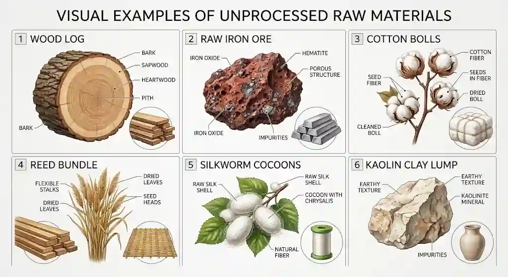

## Cutting, shaping and forming of materials

* Wood

  * Hand tools (tenon saw, coping saw, chisels): Selected for one-off production, fine joinery, and intricate internal cut-outs where high precision and tactile control are required without heavy machinery.

  * Power tools (circular saws, band saws, jigsaws): Selected for batch or high-volume production; circular saws provide fast straight rips, band saws handle complex curves, and jigsaws allow internal curved cut-outs efficiently.

* Metal

  Hacksaw: Selected for manual, low-volume cutting of solid bars, rods, or tubes where power tools are unavailable.

  * Power tools (band saws, grinders, laser cutters, waterjet cutters): Selected based on precision and material thickness; laser and waterjet cutters are chosen for intricate 2D sheet metal profiles with high edge quality and zero mechanical distortion (waterjet).

* Plastic

  * Hand saws or utility knives (scoring and snapping): Suitable for thin sheet acrylic where minimal heat generation is needed to prevent edge melting.

  * Jigsaw, router, or CNC machine: Chosen for thick or engineering polymers to achieve smooth edge profiles, holes, and complex 3D contours without chipping.

* Bending - Applying mechanical force to deform sheets or rods (e.g., line bending thermoplastic sheet or press braking sheet metal) to create rigid angular profiles without material waste.

* Casting - Pouring molten material into a mould where it solidifies into a specific shape; used when complex internal/external geometries are required (sand or die casting for metals; injection moulding for high-volume plastics).

* Forging - Shaping metal by applying compressive forces (hot or cold); improves internal grain structure, eliminating internal voids and maximizing structural strength and impact resistance for heavy-duty components.

* Extrusion - Forcing softened material through a shaped die to create a continuous profile with a fixed cross-section, used for high-volume production of pipes, rods, and window frames.

* Rolling - Passing a workpiece through rotating rollers to reduce thickness and produce uniform sheets, plates, or structural metal beams efficiently.