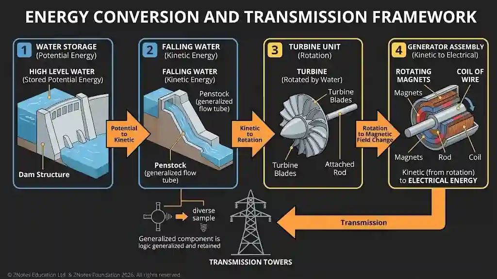

## Conversion and transmission of energy

* **Hydroelectric Conversion Example:**

  * Water is stored at a height in a dam (potential energy).

  * Falling water turns a turbine when allowed to flow, converting potential energy into kinetic energy.

  * The turbine rotates a shaft with magnets, causing the rod to rotate inside a coil of wire to generate electrical energy.

* **Simple Mechanisms:** Devices such as levers, pulleys, and gear trains transmit and modify mechanical force and motion efficiently (e.g., trading force for distance or speed).

* **Engines:** Convert chemical energy (from fuel combustion) into thermal energy and subsequently into mechanical/kinetic energy to perform work (e.g., internal combustion engines).

* **Turbines:** Convert the kinetic or pressure energy of moving fluids (such as high-pressure steam, gas, or water) into rotational mechanical energy.

* **Electric Motors:** Convert electrical energy into mechanical kinetic energy using electromagnetic induction.

