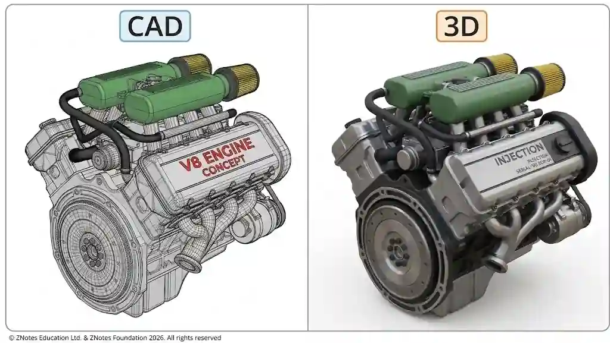

## CAD

* CAD is the digital creation, modification, and optimization of design models using computer software.

* CAD is used for storing and retrieving data, as well as manipulating images to aid in design, production, and management.

* ### **Image Manipulation**

  * *To aid design:* Designers use software tools to scale, rotate, mirror, texture-map, and render 3D surface models to visualize photorealistic appearances, check clearances, and evaluate ergonomics before production.

  * *To aid production:* Image data is manipulated to generate flat pattern layouts (nets) and nest 2D profiles tightly to minimize raw material sheet waste on cutting beds.

  * *To aid management:* Image overlays, revision tracking clouds, and annotated markups are stored centrally, allowing project managers to communicate design modifications and manufacturing tolerances clearly across distributed teams.

* A designer can save design files, specifications, and revisions digitally, allowing efficient collaboration across teams or locations.

* A designer can create, edit, and visualize designs in 2D or 3D.

* CAD can be used to directly link designs with manufacturing systems like CNC or 3D printing