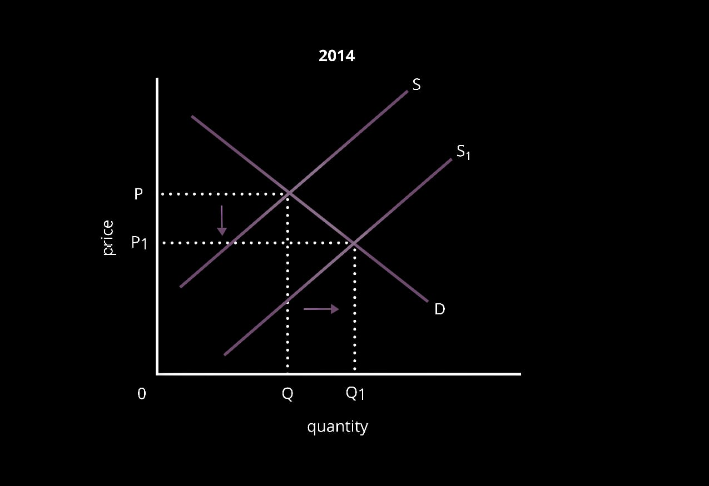
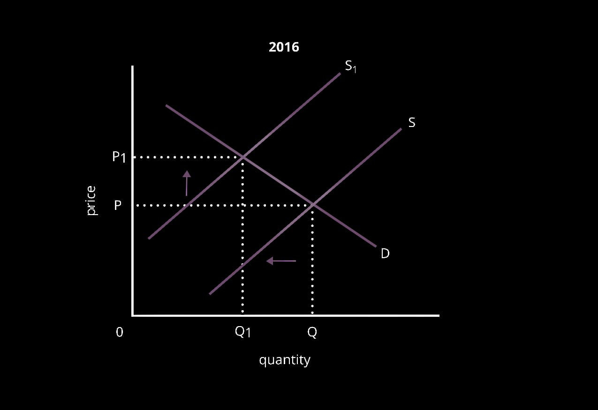
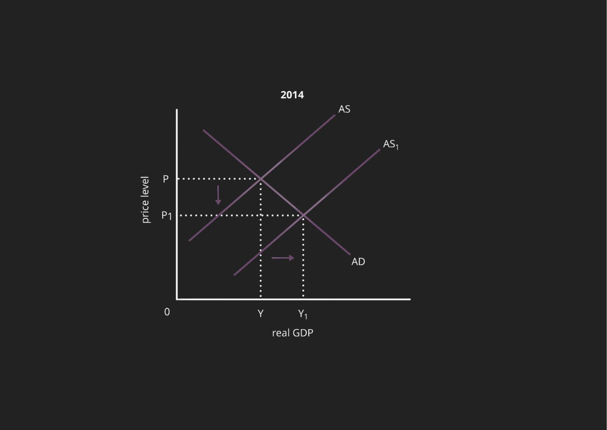
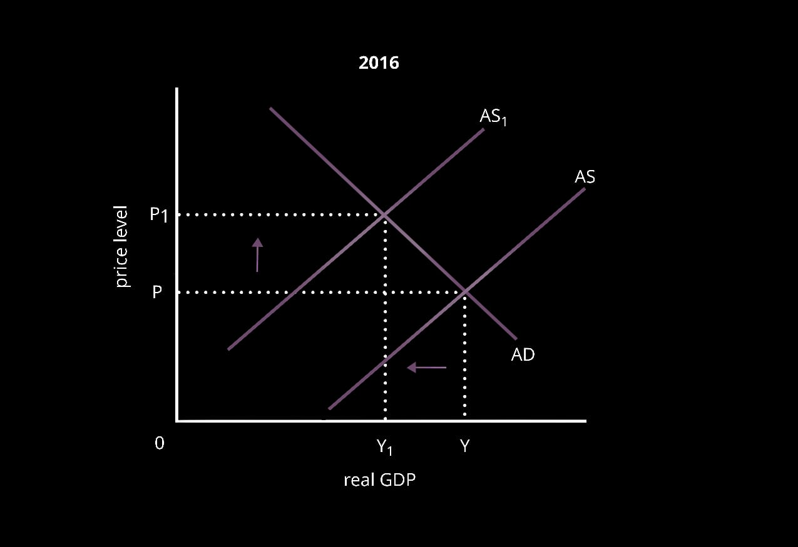

# **9708/23/M/J/19**

## **Section A**

1a) Between 2015 and 2016, oil production in Nigeria fell by 0.9 barrels per day from 2.3 barrels to 1.6 barrels each day

 \n b) In order to successfully compete against the US, in 2014, the OPEC decided to increase its supply by 12% (S-S1) which caused the price to fell by 60% to $30 per barrel (P-P1) and quantity demanded to expend (Q-Q1) \n  But, in 2016, as all economies in the OPEC were suffering due to falling oil revenue. OPEC decided to reduce its supply by 3% (S-S1) which caused price to rise by 10% (P-P1) and quantity demanded to contract (Q-Q1)

 c) Inelastic demand is when percentage change in demand is greater than percentage change in price, ceteris paribus. A fall in world price of oil by 60% only caused a 45% fall in OPEC’s revenue which shows that increase in demand was lesser than the fall in price was lesser than change in price, indicating inelastic demand.

d) Since quarter 3 of 2015, there has been a decline in the growth rate of oil production for Nigeria. Even after such a drastic decline in oil production, the Nigerian economy only contracted by 2% indicating that oil is not a significant part of the country’s GDP. It shows that contraction in other, non-oil sectors which are of greater significance in the economy’s GDP didn’t have such a drastic decline.

e) The 2 major decisions of OPEC that has a large impact on the Nigerian economy included OPEC’s policy of reducing its oil supply and increasing price in 2016 and increasing supply and reducing prices in 2014.

 

In order to remain competitive with the US, OPEC decided to increase its oil supplies and lower the world price of oil. This caused a rise in the total GDP of Nigeria, indicating short-term economic growth, high employment and living standards. But, as the world price of oil fell, Nigeria’s export revenue fell drastically as 80% of its exports were oil which worsened its current a/c balance. Later, in 2016, due to revenue issues, OPEC decided to reduce its supply in order to raise prices. This causes a rise in export revenue for Nigeria as OPEC’s oil demand is inelastic, improving its balance of payments disequilibrium. But, this led to oil producers lowering their supply and making workers redundant. That, in turn, increased unemployment and worsened living standards and economic growth prospects.

 

f) OPEC may be able to control the world price of oil as they supply half of the global demand of oil. They are a monopoly with approximately 50% of the market share. As even slight changes in their supply of oil, the entire world oil supply will be disrupted OPEC may be considered as a price marker. Also, when OPEC increased in supply by 12% in 2014, prices fell by more than 60% showcasing the effect of OPEC’s supply decisions on the world, thus on price. But, in the future OPEC may not be as successful in altering and influencing world oil prices through changes in their supply, due to the development of a new method of oil extraction - fracking by the US. This is increasingly growing in demand as it is cheaper than OPEC’s market share will reduce and their ability to influence prices will also decrease. Overall, whether or not OPEC is able to influence prices depends on how effectively they are able to implement their policies to keep oil prices high. It even depends on how efficient OPEC is in maintaining its market share while the US develops their oil industry through the method of fracking.