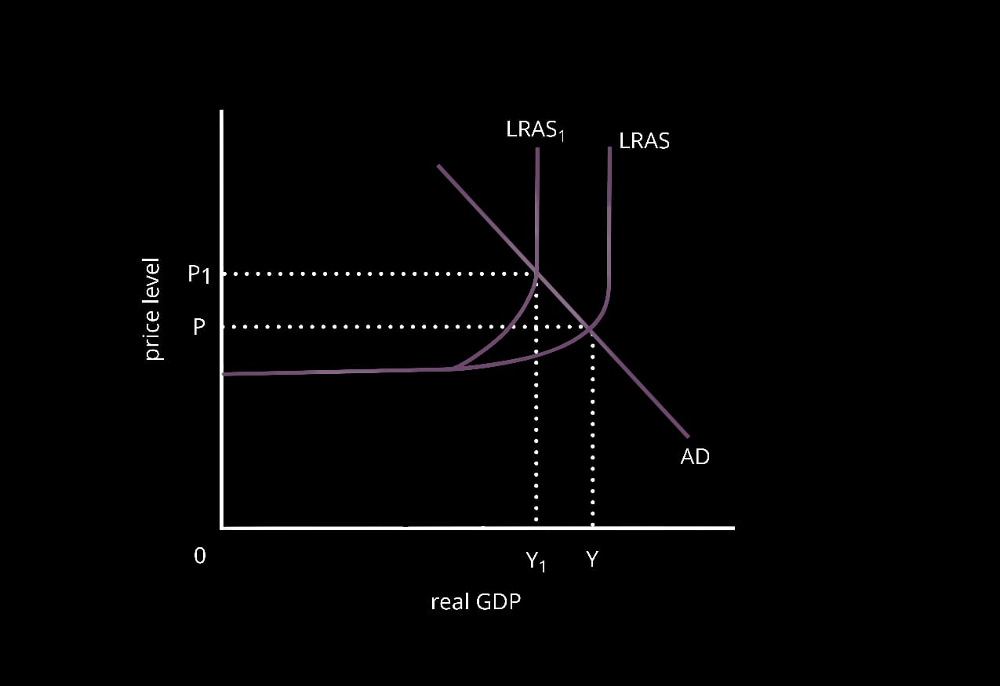
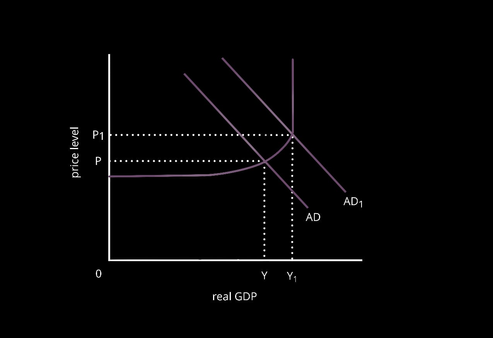

# **9708/23/M/J/19**

## **Section B**

2a. Merit goods are goods which have positive side effects when consumed. Merit goods include education, health care, etc. They generate greater social benefits when compared to social costs. As information failure  exists, consumers are not fully aware about the benefits of consuming them, which is why they are under consumed and hence, underproduced in an economy. As they are not produced and consumed at the socially optimal level, it causes market failure in an economy. Due to the existence of information failure, the government is encouraged to produce merit goods and provider awareness campaigns to help solve the problem of information failure, in turn helping increase their demand and supply. Demerit goods are goods which have negative side effects when consumed. Demerit goods include alcohol and cigarettes. They generate greater negative externalities in the economy. Due to information failure, consumers do not fully realise the negative effects of consumption of such goods due to which they are over consumed. This encourages producers to increase supply leading to overproduction. Furthermore, demerit goods are considered to be addictive in nature, making it difficult for consumers to lower its demand.  As they are not produced at a socially optimal level, market failure exists and it encourages the government to intervene in the market by taxing demerit goods and providing awareness campaigns about their negative effects.

3a. Inflation is the sustained rise in the general price level of an economy. Inflation can be cost-push or demand-pull. Cost push inflation occurs when there is a rise in a firm’s costs of production which encourages producers to increase prices leading to inflation.

 

For example, depreciation of a country’s currency increases the price of imported raw materials, leading to a rise in total costs of production and encouraging producers to raise prices in order to maintain profit levels. Another reason for cost-push inflation to occur may be due to increased wage rates, greater than the rise in workers productivity. This leads to a rise in a firm’s labour costs, increasing total costs, and leading to cost push inflation. Demand pull inflation occurs when there is a rise in any of the 4 components of AD - consumption, investment, government spending, net exports. This increased AD leads to an increase in the price level of an economy.

 For example, a cut in income tax may increase consumers' disposable incomes and their purchasing power, encouraging them to increase spending, leading to a rise in the ‘C’ component of AD and causing demand pull inflation. Also, a fall in corporation tax and interest rates will make it easier for firms to borrow more and invest in expansion and purchase of capital equipment like machinery and advanced technology. This increases the ‘I' component of AD, leading  to demand pull inflation. Also, depreciation of a country’s currency will make exports more internationally competitive as they will become cheaper. This will increase demand for exports, increasing the (X-M) component of AD, causing demand pull inflation.

3b. Inflation is the sustained rise in the general price level of an economy. It leads to a fall in the real value of money. A high rate of inflation can cause many internal and external problems for an economy. A high rate of inflation will cause an unplanned redistribution of income. During inflation, people on fixed incomes like pensions and unemployment benefits suffer as there is a fall in purchasing power of money. This leads to a fall in their living standards which may lead to a rise in poverty levels in the economy. Also, during inflation, borrowers gain as they have to pay back less in terms of real money. Furthermore, if tax brackets are not adjusted for inflation, it can cause fiscal drag when individuals are forced to pay higher taxes due to increases in their nominal income which may not represent an increase in their real income. This will lead to a fall in purchasing power of such individuals, leading to a fall in average living standards. Also, high inflation rates lead to increased costs for producers in terms of menu and shoe leather costs. Menu costs occur due to the need to continuously change prices on menu cards, catalogues, etc. Shoe leather costs occur as firms keep moving in search of financial institutions which have an interest rate higher than the current inflation rate. This increases total costs of production for firms, which may act as a disincentive for producers to lower their supply, negatively affecting the country’s GDP and employment rate as producers may make workers redundant in order to lower output. It will even lead to increased cost push inflation for the economy.  Other than the internal problems an economy faces due to increased inflation, the economy will even have to suffer a fall in their export revenue. As prices rise, exports become expensive in foreign markets, leading to a fall in their international competitiveness, encouraging consumers to switch to other, low-cost countries. This will lead to a fall in export revenue, worsening the current account deficit. Also, as domestic goods are expensive, domestic consumers may start demanding cheaper imports, increasing import expenditure. This will further worsen the currency account deficit and increase the country’s dependence on international trade. Moreover, a high inflation rate will lead to a depreciation of the country’s currency as its demand will fall due to decreased demand for exports and supply will rise due to increased demand for imports. Overall, a high and increasing rate of inflation is harmful for an economy and the government must control it. The most serious problems faced by an economy as a result of inflation may be external problems like fall in international competitiveness and depreciation of the currency as internal problems may be resolved easily by the implementation of fiscal and monetary policies. But a country does not have full control over external aspects making it difficult to control and resolve.

4a. The theory of comparative advantage suggests that an economy must specialise in a product for which it has a lower opportunity cost when compared to other countries. Free trade occurs when movement of goods and services face no trade barriers like tariffs and quotas. Trading on the basis of free trade will allow a country to specialise and produce products they are most efficient at producing. This allows maximization of limited resources - land, labour, capital & enterprise. This further helps increase global output and employment in turn improving living standards and lowering poverty. Trading on the basis of comparative advantage allows a country to consume outside their PPC curve by trading with other countries for products they are not efficient at producing. This further helps improve living standards across the globe. Also, specialising in a single product will allow the industry to grow and increase output to benefit from economies of scale like purchasing economies. This helps them lower costs and improve the quality of products produced. Also, trading on the basis of free trade will allow a country to be able to import high quality raw materials more cheaply, helping lower costs and leading to a fall in prices. This will lead to consumers enjoying cheaper and high quality products. But, the theory of comparative advantage ignores the exchange rate fluctuations which can cause a change in comparative advantage. This will make it difficult for a country to specialise in the production of one good/service.