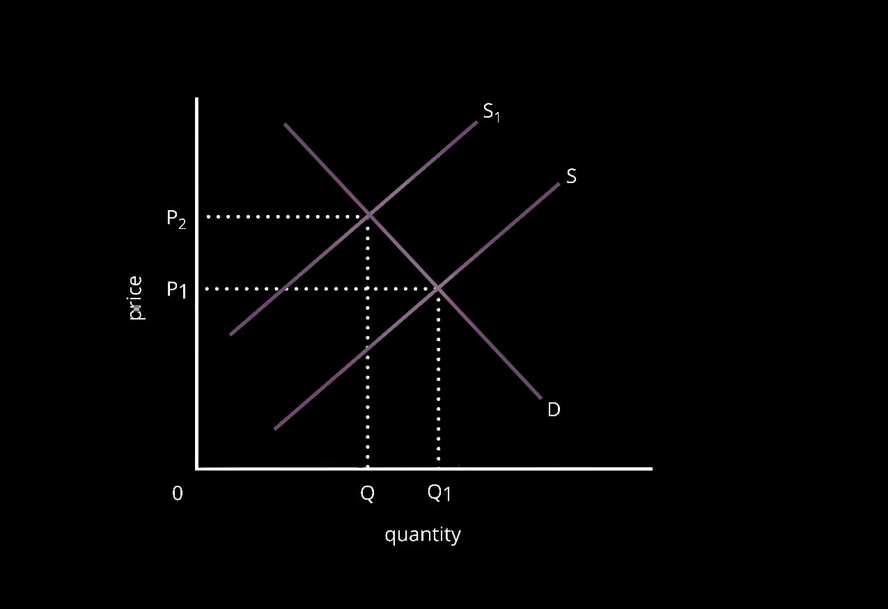
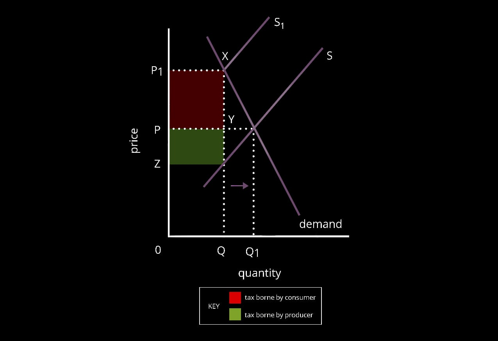
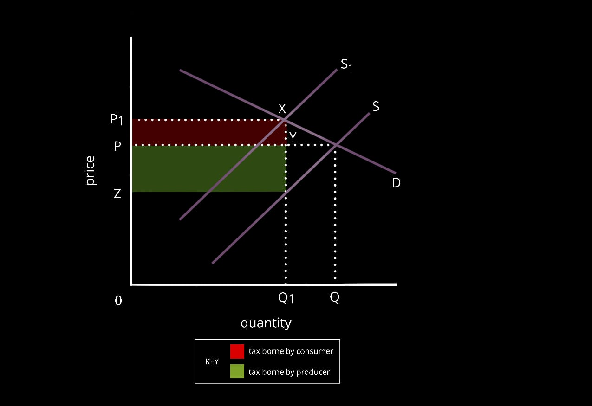

# **9708/23/M/J/20**

## Section A

1a) Plastic bottles are considered private goods as they are both excludable and rival. This occurs as plastic bottles have a charge on them, making it excludable and also are limited making them rival in nature. Plastic bottles are even considered as demerit goods as they are over-consumed and over produced due to information failure. Also, the consumption of plastic bottles leads to negative externalities like death of marine animals

b)i) A  specific tax is an indirect tax that is fixed per unit purchases. For example, $1 per bottle of alcohol purchases. An ad valorem tax is a type of tax where a fixed percentage of tax is charged on the total price for the product. For example, GST, VAT.

ii) The bottle tax the government is planning to impose is a mix of both specific and ad valorem tax as there is a fixed amount on each bottle, $0.10, however it even depends on the size of bottle purchased (1l, 2l)

c)i)   Imposition of a bottled tax on plastic bottles caused the supply curve to shift to the left (S-S1) as costs of production rose. This caused a price rise (P1-P2) leading to a contraction in quantity demanded (Q-Q1)

c)ii) The incidence of the bottled tax will depend on the price elasticity of demand of plastic bottles. When the PED of plastic bottles is inelastic, that is percentage change in price is greater than change in demand, an imposition of tax (S-S1) will lead to consumers bearing most of the tax (P1XYP) when compared to producers bearing just a small proportion of it (PYZQ).

 

Whereas, if demand is elastic, that is percentage change in price, producers will bear most of the tax (PYQZ) whereas consumers will bear a small proportion of it (P1XYP).

 

d) A tax is a charge imposed by the government. If the government taxes plastic bottles, it may be successful in reducing the consumption of plastic bottles as it will become expensive to buy it. It will be effective in reducing its production as it will become expensive. This will reduce the over-production and consumption of the demerit goods - plastic bottles. It will further help reduce the negative externalities caused by it like the threat to marine life. Also, imposing this charge will raise government revenue allowing them to spend this in reducing the negative externalities created by the production and consumption of plastic bottles.

But, the effectiveness of imposing the bottle tax will depend on the PED of plastic bottles. If plastic bottles have inelastic demand, an imposition of tax will be less likely in lowering its usage and negative externalities it causes. Also, it depends on the size of tax. A small tax may not be passed on to consumers, having no effect on consumption of plastic bottles. Instead, the government should aim to raise awareness regarding the negative effects of plastic bottles as this is likely to be more effective in reducing its consumption and production in the long run.