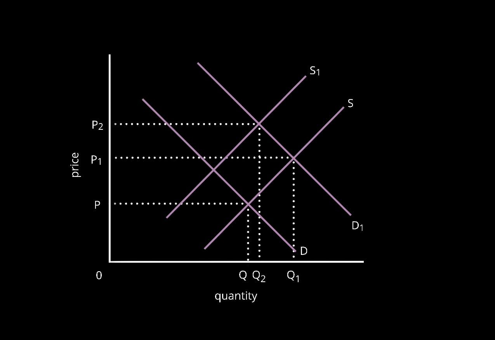
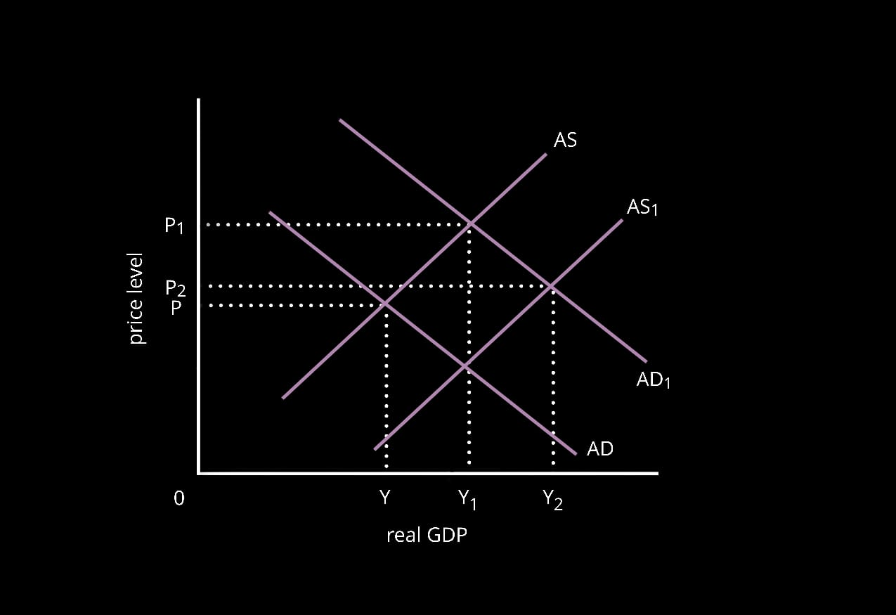

# **9708/23/O/N/19**

## Section B

2a. Demand is the willingness and ability of a consumer to buy a product. Supply is the willingness and ability of a producer to sell a product. An increase in demand for chocolate caused a right shift in the demand curve from D-D1. This led to a rise in price (P-P1) and an extension in quantity supplied (Q-Q1) as producers found it more profitable to supply chocolates encouraging them to raise their supply.  But, as supply of cocoa beans fell, which is an ingredient required in production of chocolate, suppliers were forced to lower their supply, causing a left shift in the supply curve from S-S1. As supply fell and demand rose, there was a shortage in the market. This led to a further increase in price, in order to establish an equilibrium point. But, its effect on quantity traded depends on the extent of change of both demand and supply following the changes. This led to a further rise in price to P2 and fall in quantity traded to Q2.

 

2b. Demerit goods are goods which have negative side effects when consumed. Chocolate may be an example of a demerit good. In order to reduce consumption of chocolate the government can use a variety of different policies. The government can impose an indirect sales tax on the production of chocolate. This will lead to an increase in total costs of production for chocolate producers, causing a left shift in the supply curve. This will in turn encourage producers to lower supply, further leading to an increase in price of chocolate for consumers. As it becomes expensive for both producers and consumers, consumption and production of chocolate may fall, reducing the negative externalities which are caused by it, like obesity and diabetes. But, chocolates are likely to be very addictive in nature, due to which their demand may be inelastic. This means that imposing a tax on chocolate may not help reduce its consumption as the percentage change in price will be greater than the percentage change in demand. This means that very few consumers will stop purchasing chocolates after an increase in its price, making the tax ineffective. The government can even choose to run awareness campaigns on the internet and social media platforms to inform young children about the health problems with the over consumption of chocolate. Using social media may be highly effective as it will make it easier for the government to target the younger population and it will be much cheaper. Also, as the main reason for over consumption of chocolate is the information failure, it may encourage children to reduce its demand and switch to healthier substitutes. But, these campaigns may not always be effective. Their effectiveness depends on the government's ability to fund them and implement it in convincing and persuading ways. Overall, awareness campaigns may be a better method to help reduce the over consumption of chocolate as it will help tackle the direct problem leading to the overconsumption which is information failure.

3a. Aggregate demand is the total spending on an economy’s goods and services over a given time period. AD = C+I+G+(X-M). Aggregate supply is the total output that producers are willing and able to sell in a given time period in an economy. An increase in investment in the country’s railways system will help increase AD as the ‘Investment’ and the ‘Government spending’ component rises. This leads to a rise in price, further leading to an increase in the real GDP of the economy. In order to increase GDP, producers will have to employ more people, leading to an increase in the employment rates.

An increase in investment on Indian railways will even cause a rise in the AS in the long run, as infrastructure in the economy improves. This will help lower the cost of production for businesses, encouraging them to increase output. As AS increases, employment in the economy will rise and there may be an increase in the price level. But, the extent to which the price rises in the economy depends on how close it is to full employment.

 In the short run, increased investment will cause a shift of the  AD curve (AD-AD1) leading to increase in price (P-P1) and output (Y-Y1). In the long run, AS will increase (AS-AS1) causing a fall in price level (P1-P2) and a further rise in GDP (Y2-Y3). Overall, with an increase in investment, both AD and AS will rise in an economy, which will lead to increased employment and GDP.

b. Privatisation is the sale of a state-owned public sector business to the private sector. Using privatisation for rail travel will help reduce government intervention in the economy. It helps reduce the bureaucratic system of the economy and is a process towards a market economy. A privatised business is likely to be more efficient as their main aim is profits. Due to the competitive pressure, businesses will aim to minimize costs and increase productivity. This will further encourage them to lower prices, leading to higher consumer surplus. Also, it will increase the choice available to consumers as when privatised, it will face high competitive pressure. Plus, due to the competitive pressure, businesses will be encouraged to be more innovative and creative, enhancing the quality of service provided. Furthermore, selling of the railways will generate greater revenue for the government, helping reduce its opportunity cost. It will increase funds available to the government for spending on education, health care, etc. But, the privatised industry may be a monopoly, which may encourage it to exploit customers, employees and suppliers due to the lack of competitive pressure. This may lead to higher prices and fall in efficiency as the business may be a price maker. Also, the privatised industry may but consider the negative externalities and may not operate in public benefit. They may only consider the private costs and benefits, which will lead to higher social costs, causing market failure in the economy.  Nationalisation occurs when governments take over a private sector business and transfer it to the public sector. A nationalised industry is likely to be a monopoly so it may enjoy economies of scale. This means that average costs for each rail trip will fall, leading to lower prices for consumers. Furthermore, it will consider all externalities in its decision making process. Before making any decision, the government is likely to conduct a cost benefit analysis and only make decisions which are in public benefit. But, due to lack of competitive pressure, it may be managed efficiently. Also, innovation will be discouraged due to which the quality of the railway service may be poor. Moreover, it will be funded through government revenue, due to which there will be an opportunity cost. The government could’ve used this money elsewhere, which could be of greater public benefit, like education and healthcare. Overall, it may be in the public benefit for the economy if railways are operated by the government as it is a strategic industry and be controlled by the government. Furthermore, it will avoid duplication of scarce resources like rail tracks, trains, etc. But, it depends on whether the privatised industry will be a monopoly or not.

4a. The current account is a record of the trade in goods, trade in services, investment income and current transfers within the balance of payments of an economy. A current account deficit occurs when the expenditure on imports exceeds the revenue earned from exports. A current account deficit may occur due to high inflation rates in the country when compared to other, competing countries. If this occurs, demand for the country’s agricultural goods will fall as they will become more expensive due to a loss of international competitiveness. This will further lead to a fall in the total export revenue earned by the economy, leading to a worsened current account deficit. Also, as inflation rate is high, domestic consumers may find it easier and cheaper to import goods from other countries rather than purchase them in the home country, leading to a rise in import expenditure, further increasing the deficit. Another reason for a current account deficit to develop may be a fall in productivity of factors of production. A fall in productivity will lead to an increase in the total costs of producing agricultural products, leading to an increase in the price and a fall in its quality. This will lead to lost international competitiveness, encouraging international customers to switch to competitors, leading to a fall in export revenue and worsened current account balance. Furthermore, if developed countries impose trade barriers like tariffs and quotas on the country’s agricultural products, it will further increase their prices, causing a fall in demand. This will cause a fall in export revenue and therefore the current account balance.

4b. Current account deficit occurs when import expenditure exceeds export revenue. In order to reduce the current account deficit, the US government can implement fiscal, monetary or supply-side policies. In order to reduce the currency account deficit, the US government can adopt contractionary fiscal policy measures which includes increased taxation and reduction in government spending. Increase in tariffs will make imports into the US economy more expensive, encouraging consumers to lower spending on imports and switch to exports. As import expenditure falls, current account balance will improve. Also, increase in taxation will reduce consumers' disposable incomes helping lower their purchasing power. This will in turn lead to reduced spending on imports, lowering import expenditure and improving the balance of payments position. Furthermore, reduction in purchasing power will reduce domestic demand, allowing producers to increase exports. As export revenue increases and import expenditure falls, the current account will be improved. But, this is an expenditure-reducing method, which aims to lower AD, which will increase the risk of recession and bad deflation. If the fall in domestic demand is not offset by exports, there will be a fall in economic growth and rise in unemployment in the US economy. The government can even use contractionary monetary policies, which involves increased interest rates, reduction in money supply and depreciation of the currency. Depreciation of the currency will make imports more expensive in the domestic market and exports cheaper in international markets. As imports become more expensive, people will switch to domestic producers, lowering total import expenditure. Also, as exports are cheaper in international markets, international competitiveness will increase, leading to a rise in demand for the country’s exports, increasing total export revenue. Increased export revenue and a fall in import expenditure will lead to a fall in the current account deficit, improving the balance of payments. But, it will increase the risk of inflation. As demand for exports rises, (X-M) component of AD will increase, leading to price rises and causing demand pull inflation. Increasing interest rates may also help reduce the current account deficit as it will make borrowing more expensive and increase the return on savings, encouraging people to save. As people’s purchasing power falls, the C component of AD reduces, leading to a fall in import expenditure. But, this is an expenditure-reducing method which may lead to recession and unemployment in the long run. The government can even use supply-side policy measures to reduce current account deficit.  Supply side policy measures are designed to increase aggregate supply (AS). Supply side policy measures may include increased education and training, privatisation, deregulation, labour market reforms, tax incentives, etc. Increase in education and training helps improve labour productivity, improving the quality of output produced, leading to increase in international competitiveness. This will even lead to an increase in exports from the US, , improving their current account balance. But, this will only be effective if the quality of education and training provided rises. Also, such policies are expensive and their effectiveness depends on the government’s ability to fund them. Overall, the type of policy used by the US government depends on the cause of the current account deficit. A cyclical deficit is not likely to be a problem for the government, but a structural deficit will require government intervention to be corrected. Therefore, for a structural deficit, the government should adopt supply side policies because it will directly help tackle problems which are causing a fall in the country’s international competitiveness.