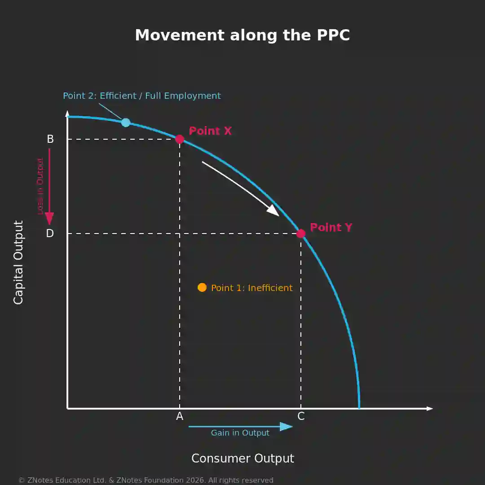
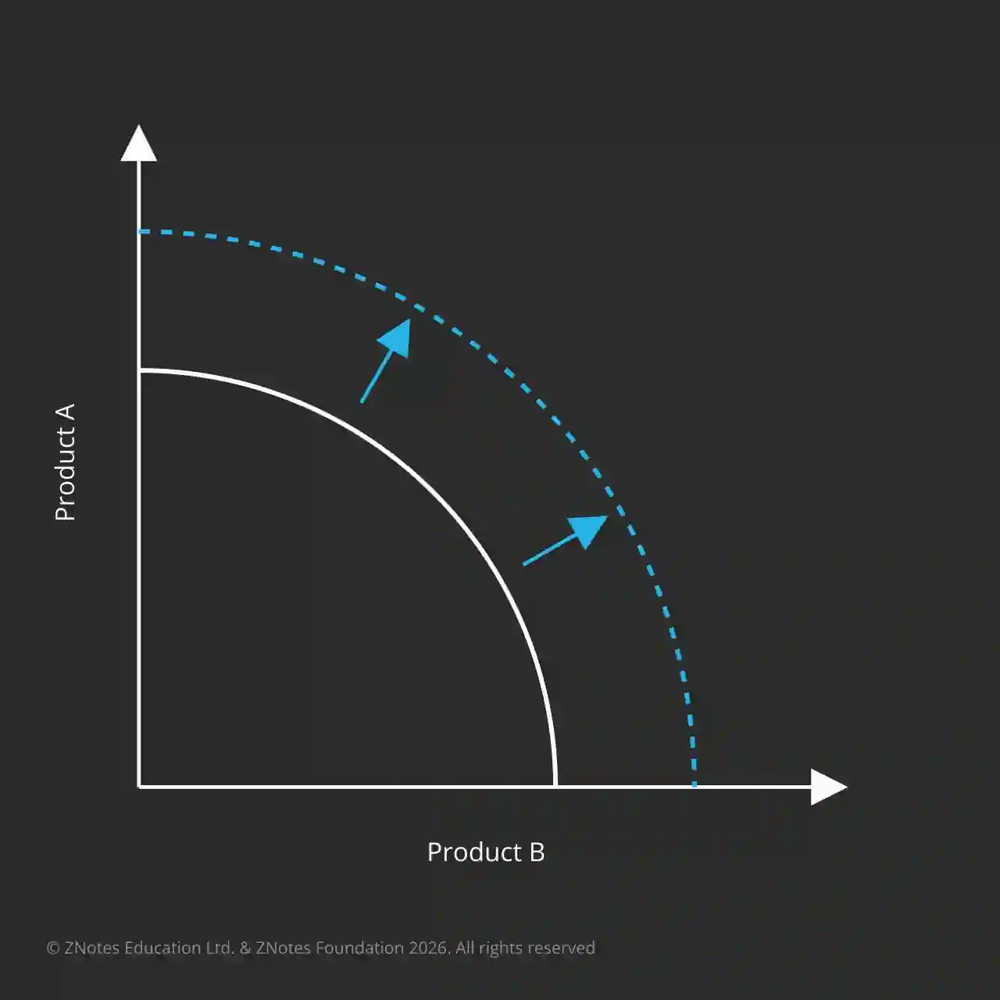
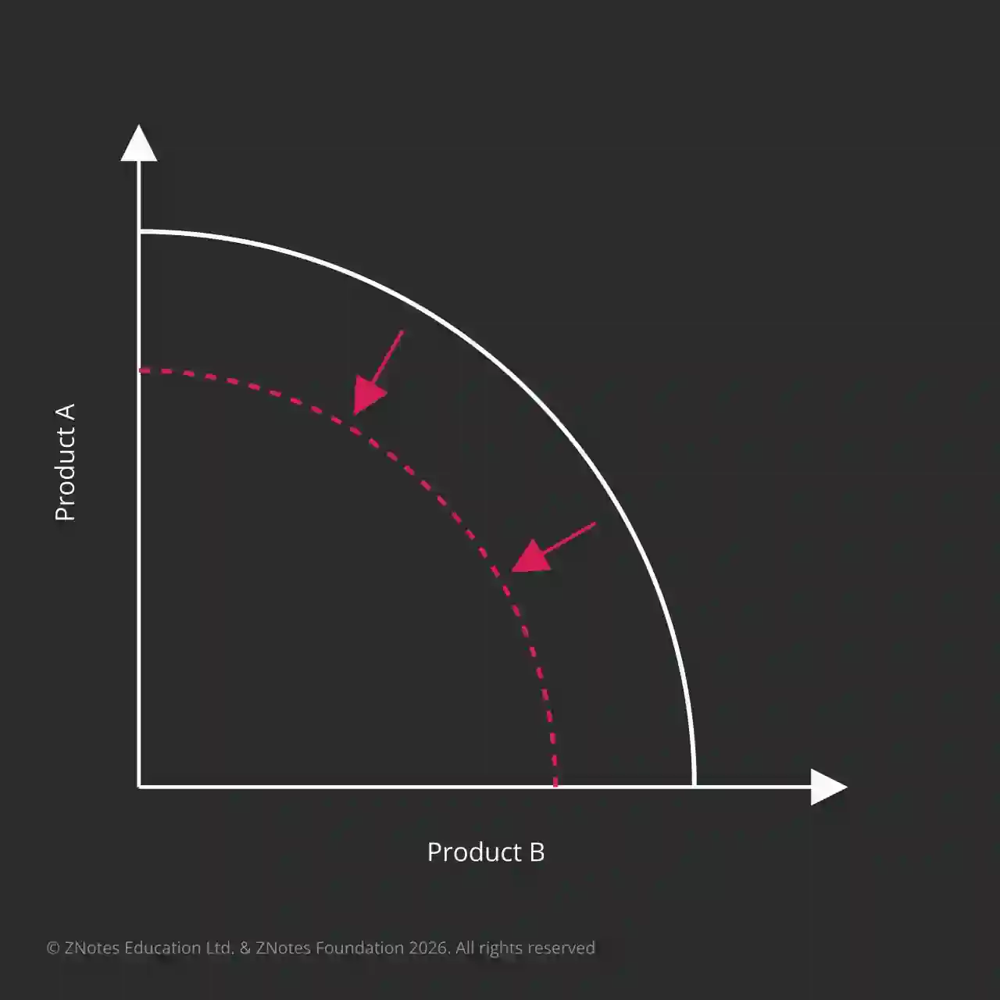

# **Basic economic ideas and resource allocations**

## Production possibility curve 

### 5.1 Production possibility curve 

* Definition: A PPC shows the maximum possible output combinations of two goods that an economy can produce using its available resources and technology. Also called the Production Possibility Frontier (PPF).

* Assumptions: 

The basic PPC model assumes:

* Only **two goods** are being produced.

* Available resources are being fully utilised.

* Production technology is given/fixed.

* Resources are allocated between the two industries.

  

* **Purpose -\>** Shows the maximum possible output that can be achieved; does this by illustrating the idea of choice and opportunity cost

  

Graph Explanation: 

* increasing the output of one product → decreases the output of the other product due to limited resources.

* Opportunity Cost of increasing Output A → the loss in Output B. This represents the cost of the next best alternative forgone.

* Important → A movement from one point to another along the PPC shows a change in the combination of output produced. It does not represent a shift of the entire PPC.

* Point X →

  * Consumer goods output = A

  * Capital goods output = B

* Point Y →

  * Consumer goods output = C

  * Capital goods output = D

* Point 1 → Inefficient use of resources

  * Represents unemployment / underutilisation of resources

  * Located inside the PPC

  * Not all available resources are being used

  * Actual output is below potential output

* Point 2 → Efficient use of resources

  * Represents full employment / full utilisation of resources

  * Lies on the PPC

  * All available resources are being efficiently used

  * Economy is producing at its maximum productive capacity.

  ### Shape of the PPC

  * Why is the PPC curved? → Because returns are not constant.

  * Constant Returns → The amount of one product sacrificed for another would remain the same.

  * Law of Diminishing Returns → As more inputs are added, the extra output produced gets smaller.

### Constant & Increasing Opportunity Costs

* PPC is NOT a straight line → Because opportunity cost can increase as production changes.

* Increasing Opportunity Cost → Producing more of one good requires sacrificing increasing amounts of the other good.

* Reason → Different factors of production (FOPs) have different levels of suitability.

* Example → To produce more of a good, the country must use more resources that are less suitable for producing it.

* Less suitable FOPs used → Higher marginal cost of production.

### Causes & Consequences of Shifts in PPC

* Disclaimer → Figure shows a shift of the entire PPC.

* PPC shifts to the right (PPC1 → PPC2) → Economy can produce more of both goods.

  * Economic Growth → Increase in an economy's productive potential/capacity, allowing it to produce more goods and services.

* Point X → Inefficient use of resources → Unemployment

* Point Y → Efficient use of resources → Full Empl**oyment**

### **Causes of a Shift of PPC to the Right**

1. ### Causes of a Rightward Shift → 📈

   1. Investment in Technology → Higher productivity → Greater future productive capacity

      * Example → Investment in machinery/capital equipment.

   2. Introduction of New Resources → Increases the economy's ability to produce.

      * Example → Discovery of new mineral deposits.

   3. Increase in Labour Supply → More workers available → Greater productive capacity.

      * Examples → Increased immigration or birth rate.

   4. Improvement in Human Capital → Education & training improve workers' skills → Higher productivity.

   5. Better Management of Resources → More efficient production methods → Greater output.

      * Example → Greater division of labour → Higher productivity.

   6. Encouragement of Enterprise Culture → Government support for new firms → Increased productive capacity.

      * Examples → Financial support, information and resources.

### **Causes of a Shift of PPC to the Left**

1. **Migration out of Country (Emmigration)**

2. **Reducing Labour Supply**

3. **Reduction in Financing Educational Initiatives -\>** Reduces the quality of the future labour force