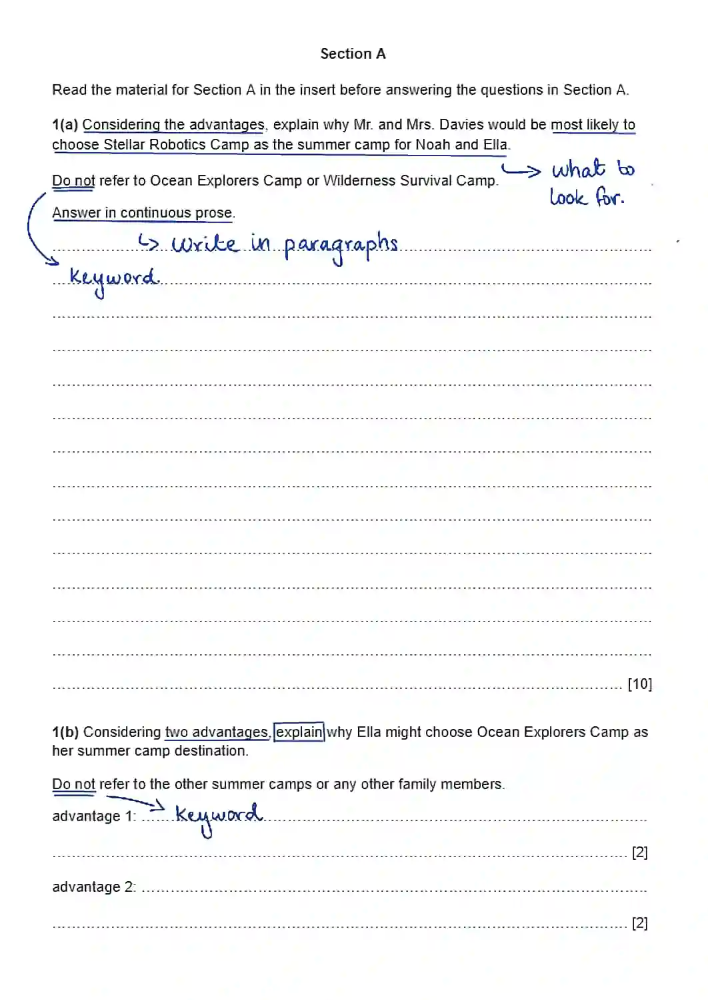
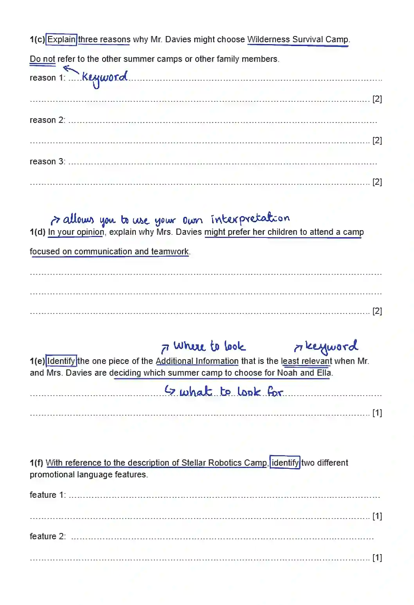
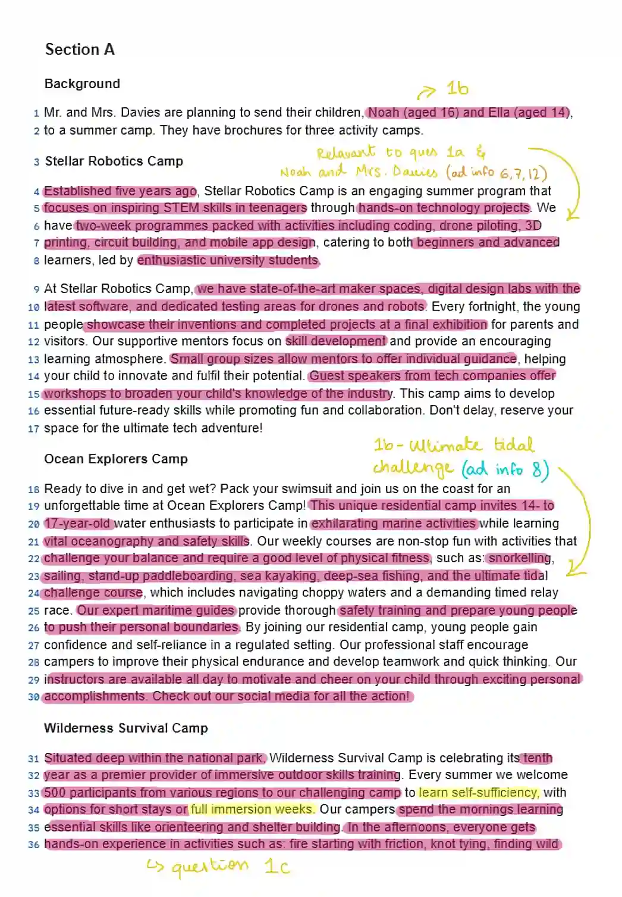
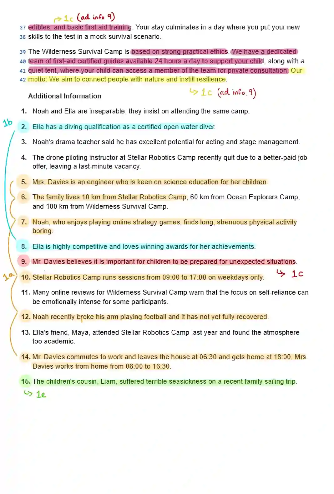

## Walkthrough example - Section A

Refer to this example of annotating a paper; for this example, I used sample paper that demonstrate the same skills required to annotate a official exam paper.

### Section A

Section A questions are typically harder as they present a situation in a simulation-like format. Data is often given in a jumbled order, which requires careful connection to construct answers. Be extra attentive when annotating this section.

1. Look at the questions first and understand what to focus on.

* Before you begin to practice annotating, learn and understand the command words in your syllabus. (command words are annotated in a box)

For the questions above, here is how I would annotate the insert:

* Pink = annotations made during first read

* Yellow = annotations made after using additional info with the rest of the insert to bridge ideas and events.

* On the additional info page, I used multiple colours to signify that points in the same colour are connected and for a specific question.

### Section A answers -

Now, with reference to all the annotations above, my answers would be something like this:

---

**1(a)** Mr. and Mrs. Davies would be most likely to choose Stellar Robotics Camp because it aligns with several of their family's needs and interests. Stellar Robotics Camp runs on weekdays from 09:00 to 17:00 , which is quite compatible with Mrs. Davies' work-from-home schedule of 08:00 to 16:30, allowing her to manage drop-off and pick-up easily. The camp is also the closest to their home, situated only 10 km away. This is a significant advantage, as Mr. Davies' long commute (leaving at 06:30 and returning at 18:00) makes travel time an important consideration. Furthermore, Mrs. Davies is an engineer and is keen on science education for her children, and this camp focuses on inspiring STEM skills, which would appeal directly to her. The camp offers a wide variety of engaging, technology-focused activities like coding, drone piloting, and 3D printing, which is suitable for Noah, who enjoys playing online strategy games and dislikes long, strenuous physical activity. Finally, the camp uses small group sizes for individual guidance and offers a supportive atmosphere, which may be reassuring given that Noah's arm has not fully recovered from a recent break.

---

**1(b)** *++advantage 1:++* The camp is designed for 14- to 17-year-old water enthusiasts, which directly appeals to Ella's existing proficiency and interest as she already holds a diving qualification as a certified open water diver.

*++advantage 2:++* The camp's courses are non-stop fun and include challenging activities such as the ultimate tidal challenge course, which would appeal to Ella since she is highly competitive and loves winning awards for her achievements.

---

**1(c)** *++reason 1:++* Mr. Davies believes it is important for children to be prepared for unexpected situations, and the camp teaches practical skills like orienteering, shelter building, and basic first aid training.

*++reason 2:++* The camp's motto is to "connect people with nature and instill resilience", which aligns with his goal of preparing his children for challenging circumstances.

*++reason 3:++* The camp offers full immersion weeks, which would provide a deep, hands-on experience in learning self-sufficiency.

---

**1(d)** As an engineer, Mrs. Davies would likely value a camp that develops soft skills like communication and teamwork, as these are crucial for successful collaboration and project management in a professional STEM environment.

---

**1(e)** The children's cousin, Liam, suffered terrible seasickness on a recent family sailing trip.

---

**1(f)** *++feature 1:++* Use of emotive language or exaggeration, such as "ultimate tech adventure".

*++feature 2:++* Use of a direct address or imperative, such as "Don't delay, reserve your space...".