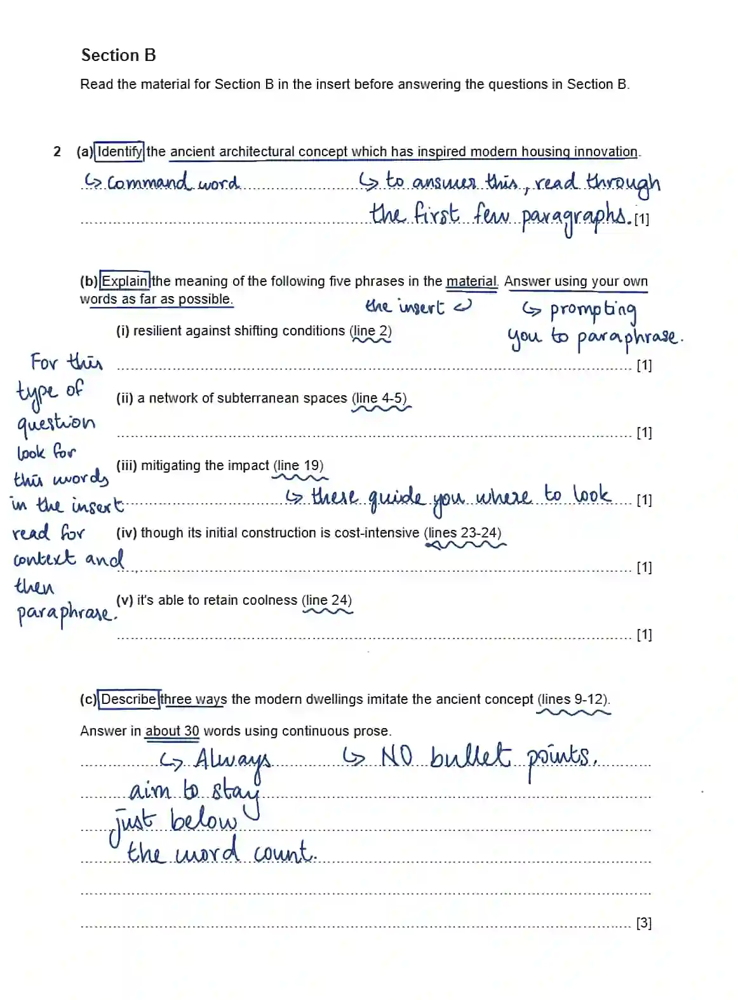
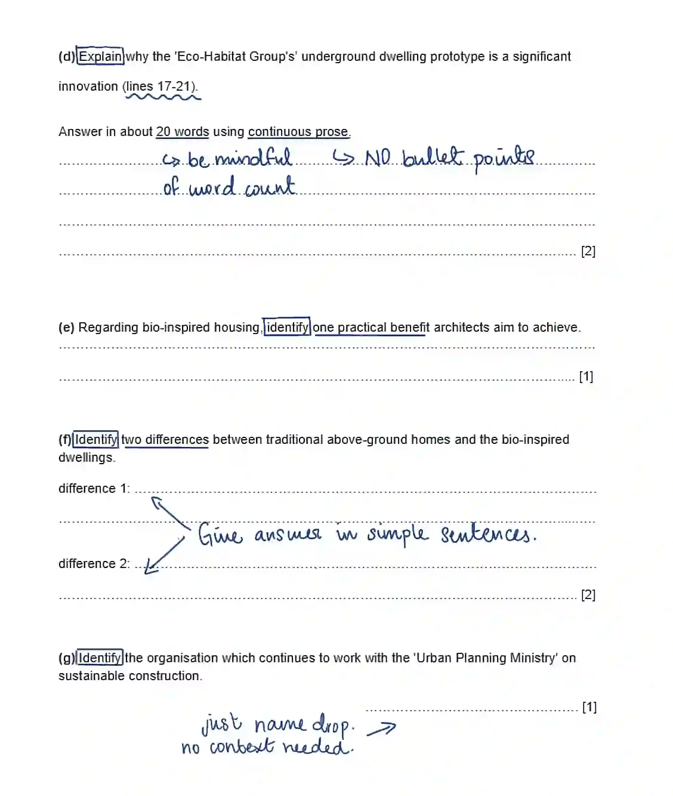
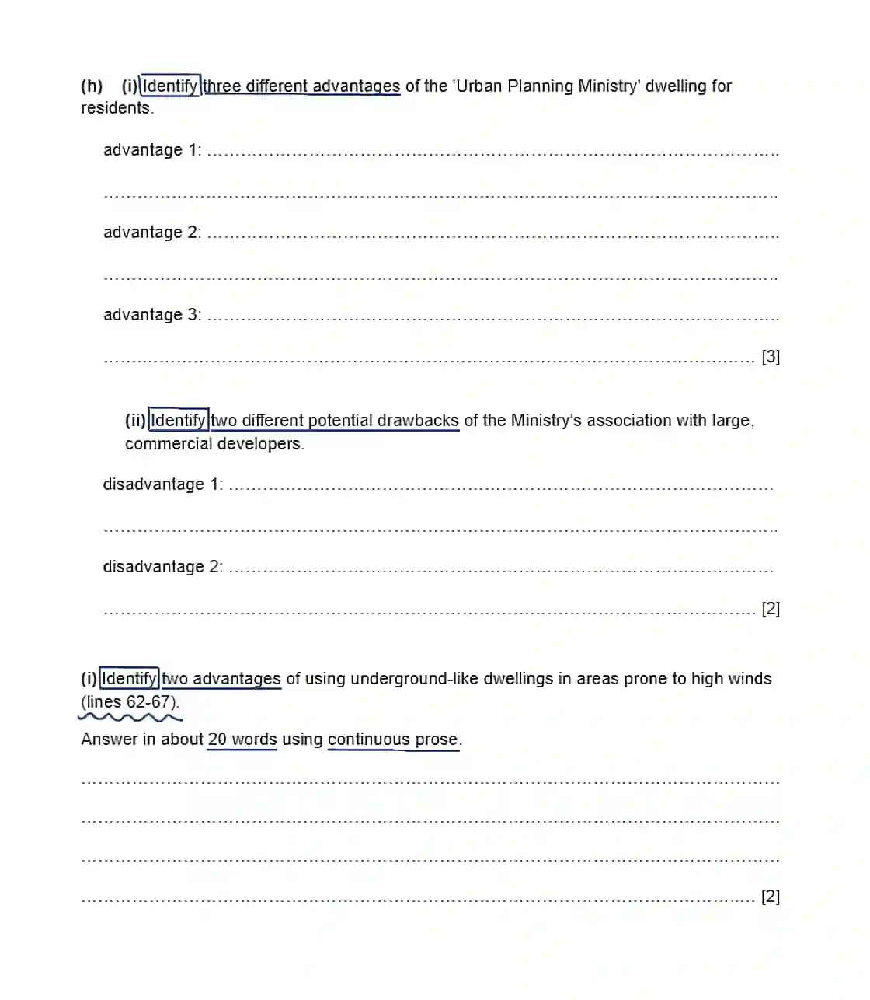
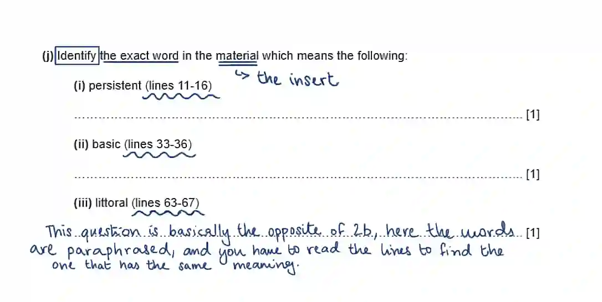
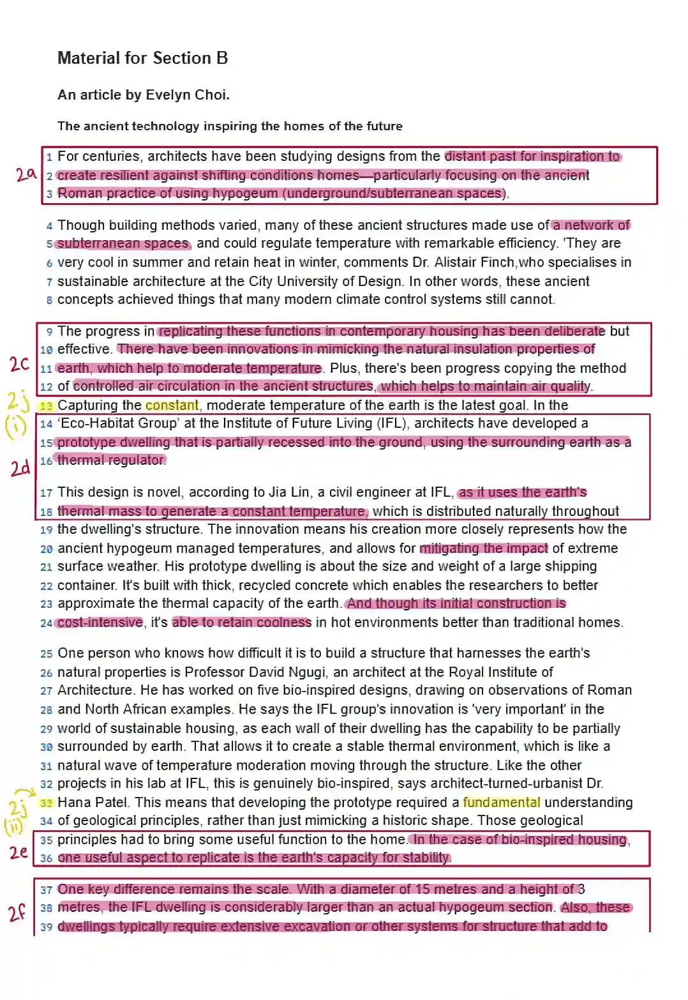
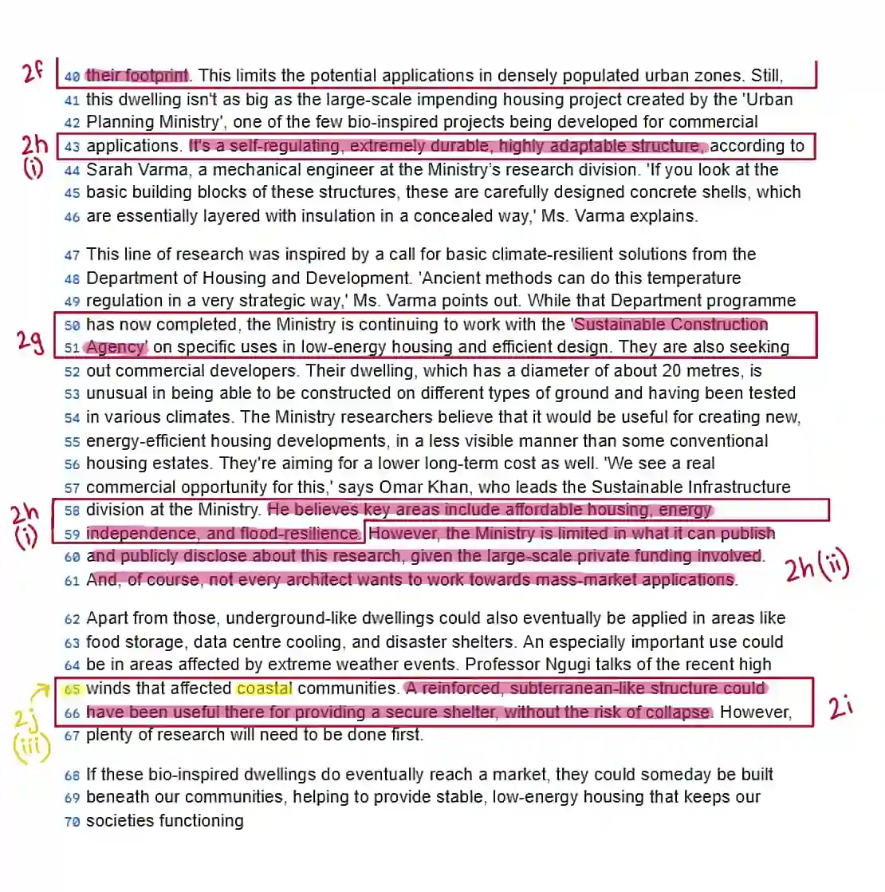

## Section B

Now, similarly, answer Section B. This section is easier to construct answers for, as the information is not scattered. Take a look at my example:

For each question that included relevant line references, I have placed those lines in a box. Key points for the questions are highlighted in pink, while the words and phrases for the final question are highlighted in yellow.

* Notice that the questions follow a chronological sequence. This is often the case, so there’s no need to worry about linking information from different parts of the text.

### Section B answers -

**2 (a)** The ancient Roman practice of using hypogeum (underground/subterranean spaces).

---

**2 (b)** i. Strong enough to withstand or recover quickly from changing or variable environmental factors.

---

**2 (b)** ii. A connected system of rooms or passages situated completely below the surface of the earth.

---

**2 (b)** iii. Reducing the severity or harmful effects of something (like extreme weather).

---

**2 (b)** iv. Even though the first stage of building requires a large amount of money.

---

**2 (b)** v. It has the capacity to keep the interior temperature low or chilled.

---

**2 (c)** The modern dwellings imitate the ancient concept by mimicking the natural insulation properties of the earth, copying the method of controlled air circulation, and leveraging the earth's thermal mass to generate a constant temperature.

---

**2 (d)** It is significant because its design uses the earth's thermal mass to generate a constant temperature throughout the structure, closely approximating ancient regulation methods.

---

**2 (e)** They aim to replicate the earth's capacity for stability or to achieve a constant, moderate temperature.

---

**2 (f)** *++difference 1:++* The bio-inspired dwellings require extensive excavation or other systems for structure that add to their footprint, unlike most traditional homes.

*++difference 2:++* The bio-inspired dwellings are considerably larger than the ancient hypogeum that inspired them, the IFL dwelling is 15 metres in diameter.

---

**2 (g)** The Sustainable Construction Agency.

---

**2 (h)** 1. *++advantage 1:++* It is a self-regulating structure (for temperature).

*++advantage 2:++* It is an extremely durable structure.

*++advantage 3:++* It offers potential benefits in energy independence and flood-resilience. (Accept any two from the list of benefits: affordable housing, energy independence, flood-resilience).

---

**2 (h)** ii. *++disadvantage 1:++* The Ministry is limited in what it can publish and publicly disclose about the research.

*++disadvantage 2:++* Not every architect wants to work towards mass-market applications.

---

**2 (i)** A reinforced, subterranean-like structure could provide a secure shelter and remove the risk of collapse during extreme weather.

---

**2 (j)** i. Constant

**2 (j)** ii. Fundemental

**2 (j)** iii. Coastal