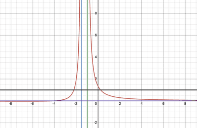

## Inequalities

Inequalities are used to find the interval of $x$ values that are below or above a certain $y$ value of a rational function. There are 2 methods to find the interval.

$$

\phantom{this text is invis}
$$

 Method 1 

Imagine a rational function, where you’re asked to find the values less than a constant $y$ value.

$$

\frac{1}{(ax + b)} < y
$$

We cannot cross multiply by $ax + b$ as we are uncertain if the inequality sign will change. To fix this issue, we multiply both sides by $(ax + b)^2$ as this value is always positive.

This leads us to solve the equation

$$

\frac{(ax + b)^2}{(ax + b)} < y(ax + b)^2 \implies ax + b < y(ax + b)^2
$$

* If the denominator is already squared, we can directly cross multiply as this value is always positive.

Method 2

The next method involves the utilisation of a sketched rational function.

Let’s use the graph:

$$

y = \frac{x + 4}{(2x + 3)(x + 1)}
$$

 

* The red curve represents our rational function
  * The blue line represents the vertical asymptote $x = \frac{-3}{2}$
  * The green line represents the vertical asymptote $x = -1$
  * The purple line represents the horizontal asymptote $y = 0$

We are now required to the interval of $x$ where

$$

\frac{x + 4}{(2x + 3)(x + 1)} > 1
$$

 

* The black line represents $y = 1$

We can now find the value of $x$ where $y = 1$

$$

\frac{x + 4}{(2x + 3)(x + 1)} = 1
$$

$$

\implies 2x^2 + 4x - 1 \ = \ 0
$$

$$

\implies x = -1 \pm \frac{\sqrt{6}}{2}
$$

Using the sketch and asymptotes, we can now determine the interval as:

$$

-1 - \frac{\sqrt{6}}{2} < x < \frac{-3}{2}
$$

$$

-1 < x < -1 + \frac{\sqrt{6}}{2}
$$

