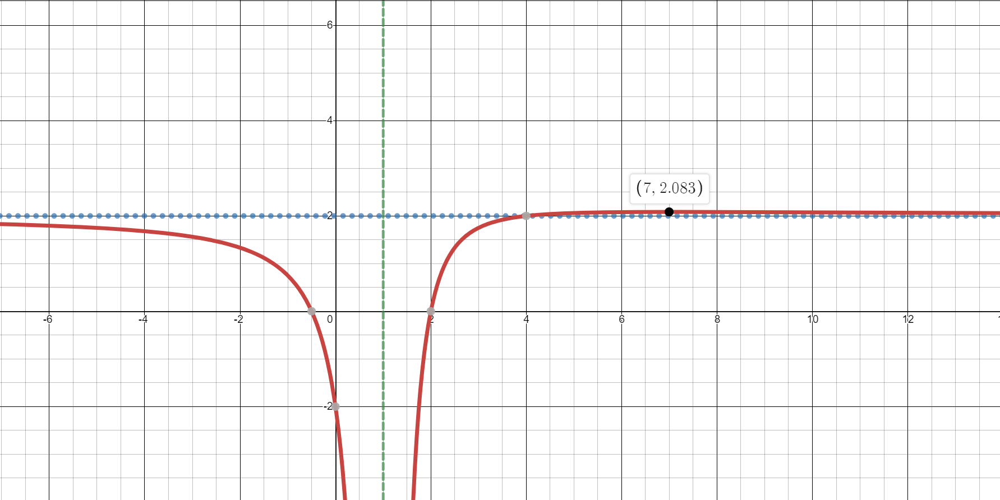

## Curve Sketching

- When you sketch the curve, include the following:
    
  - $y$-intercept
    
  - $x$-intercepts
    
  - Stationary points (maxima, minima, inflections)
    
  - Vertical asymptote(s)
    
  - Horizontal or oblique asymptote(s)

*{SP20-P01} Question 7*

The Curve $C$ has equation
$y = \frac{2x^{2} - 3x - 2}{x^{2} - 2x + 1}$

a)  State the equations of the asymptotes of $C$

b)  Show that $y \leq \frac{25}{12}$at all points on $C$

c)  Find the coordinates of any stationary points of $C$

d)  Sketch $\mathbf{C}$, stating the coordinates of any
    intersections of $\mathbf{C}$ with the coordinate axes and the
    asymptotes

$$
\text{Solution}
$$

In order to find all the asymptotes, we will have to split the
improper fraction as much as possible:

Apply polynomial division to our function:

$$
y = \frac{2x^{2} - 3x - 2}{x^{2} - 2x + 1} = 2 + \frac{x + 2}{\left( x - 1 \right)^{2}}
$$

As $\text{x } \rightarrow \infty$, $y\  = 2$ which is our
horizontal asymptote

Our vertical asymptote will be when the denominator =0, which means:

$$
\left( x - 1 \right)^{2} = 0
$$

$$
x = 1
$$

Therefore, the equations of asymptotes are:

$$
y = 2,\mathbf{\quad}x = 1\mathbf{\quad}\mathrm{(Ans\ for\ a)}
$$

To show the range of $C$, we will be using the discriminant
$b^{2} - 4ac < 0$ to show the values where $y$ do not exist.

Rearrange terms:

$$
y = \frac{2x^{2} - 3x - 2}{x^{2} - 2x + 1}
$$

$$
\rightarrow x^{2}y - 2xy + y = 2x^{2} - 3x - 2
$$

$$
\rightarrow \left( y - 2 \right)x^{2} + \left( 3 - 2y \right)x + \left( 2 + y \right) = 0
$$

Applying discriminant:

$$
\left( 3 - 2y \right)^{2} - 4\left( y - 2 \right)\left( 2 + y \right) < 0
$$

$$
\rightarrow 25\  - \ 12y\  < 0
$$

$$
y > \frac{25}{12}
$$

We found the Range of values for $y$ that DO NOT EXIST, this
implies the range of values where $y$ exists is at:

$$
y \leq \frac{25}{12}\mathbf{\quad}\mathrm{(Ans\ for\ b)}
$$

Of course, we will have to differentiate the function in order to find
the stationary points, differentiating it we get:

$$\frac{\text{dy}}{\text{dx}} = \frac{7 - x}{\left( x - 1 \right)^{3}}
$$

Equate $\frac{\text{dy}}{\text{dx}} = 0$ :

$$
\frac{7 - x}{\left( x - 1 \right)^{3}}\  = 0
$$

$$
\rightarrow x = 7
$$

Putting the $x$-value to the function to give its
$y$-value, we get $y = \frac{25}{12}$. Which is just the
highest point in our graph.

$$
\left( 7,\ \frac{25}{12} \right)\mathbf{\quad}\mathrm{(Ans\ for\ c)}
$$

**(Ans for d)**
