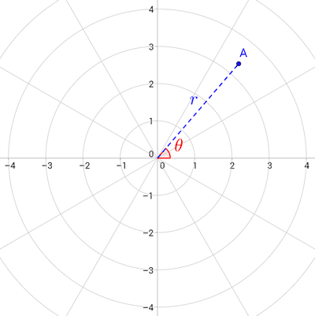

# Polar Coordinates

## Introduction

The polar coordinate system is similar to the cartesian coordinate system. Instead of measuring horizontal or vertical distances, the polar coordinate system measures the distance ($r$) from the pole and the angle ($\theta$) required to be rotated from the positive $x$-axis also known as the polar axis.

* A point, $A$, has coordinates $\left( r,\theta \right)$ where:
  * $r$ is the distance from the pole, also known as the origin $O$.
  * $\theta$ is radian angle measured **counterclockwise** from the **positive** $x$-axis to the radius $\text{OA}$

 

