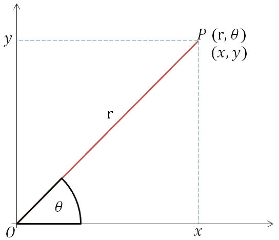

## Converting Between Cartesian and Polar Coordinates

To convert from cartesian coordinates to the polar coordinate system, we will use some basic results.

 **
Using trigonometry
**

| $x = rcos(\theta)$ | $y = rsin(\theta)$ |
|----|----|
| $r = \sqrt{x^2 + y^2}$ | $tan(\theta) = \frac{y}{x}$ |

* To convert a cartesian coordinate (3, 4) to polar coordinates ($r, \theta$)
  * $r = \sqrt{3^2 + 4^2} = 4$
  * $\theta = tan^{-1}(\frac{4}{3}) = 0.93 ~ \text{rad}$
  * Resulting in the polar coordinates $(4, 0.93)$.
* To convert a polar coordinate $(4, \frac{\pi}{4})$ to cartesian coordinates $(x, y)$
  * $x = 4cos(\frac{\pi}{4}) = 2\sqrt{2}$
  * $y = 4sin(\frac{\pi}{4}) = 2\sqrt{2}$
  * Resulting in the cartesian coordinates $(2\sqrt{2}, 2\sqrt{2})$.

---

{S04-P01} Question 3:

The curve $\mathbf{C}$ has equation

$$
\left( \mathbf{x}^{\mathbf{2}} + \mathbf{y}^{\mathbf{2}} \right)^{\mathbf{2}} = \mathbf{4}\mathbf{\text{xy}}
$$

Show that the polar equation of $\mathbf{C}$ is $\mathbf{r}^{\mathbf{2}} = \mathbf{2}\mathbf{\sin}{\mathbf{2}\mathbf{\theta}} $

Solution:

Using identities, form an equation in terms of $\mathbf{r}$ and $\mathbf{\theta}$

$$
\left( \mathbf{r}^{\mathbf{2}} \right)^{\mathbf{2}} = \mathbf{4}(\mathbf{r}\mathbf{\cos}({\mathbf{\theta}))(\mathbf{r}\mathbf{\sin}({\mathbf{\theta})}})
$$

$$
\mathbf{r}^{\mathbf{4}} = \mathbf{2}\mathbf{r}^{\mathbf{2}}(2\mathbf{\cos}({\mathbf{\theta})\mathbf{\sin}(\mathbf{\theta}}))
$$

$$
\implies \mathbf{r}^{\mathbf{2}} = \mathbf{2}\mathbf{\sin}{\mathbf{2}\mathbf{\theta}}
$$

