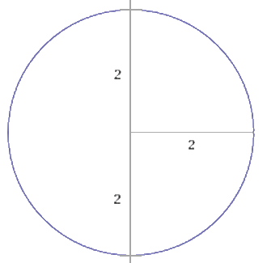
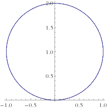
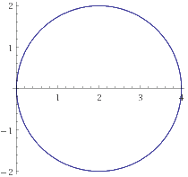
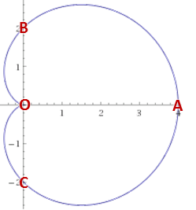
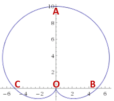
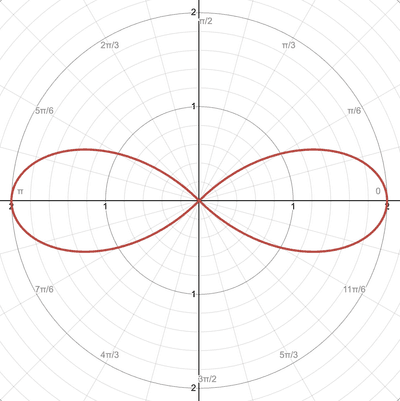
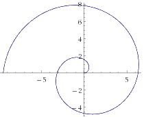
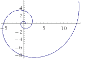

## Sketching Polar Curves

Curve sketching:

* Use your calculator’s table function to work out key values of $r$, by using the required range of $\theta$ values with a suitable step.
* Determine the values of $\theta$ when $r = 0$
* Make use of lines of symmetry, such as the polar axis, pole and the line $\theta = \frac{\pi}{2}$.
* The convention $r \geq 0$ will be used in the syllabus
* You may be asked to sketch polar curves for $0 \leq \theta \leq 2\pi$, $-\pi \leq \theta \leq \pi$ or a subset of either of these intervals

### **Lines**

* $r = asec(\theta)$
  * Vertical line at $x = a$
* $r = acosec(\theta)$
  * Horizontal line at $y = a$

### **Circles**

* $r = a$
  * Radius is $a$
  * Centre of circle: $(0,\ 0)$

 

$$
r = 2
$$

* $r = a\sin\theta$
  * Diameter is $a$
  * Centre of circle: $\left( 0,\frac{a}{2} \right)$

 

$$
r = 2\sin(\theta)
$$

* $r = a\cos(\theta)$
  * Diameter is $a$
  * Centre of circle: $\left( \frac{a}{2},\ 0 \right)$

 

$$
r = 4\cos(\theta)
$$

### **Cardioids**

* $r = a + a\cos(\theta)$
  * $\left| \text{OA} \right| = 2a$
  * $\left| \text{OB} \right| = \left| \text{OC} \right| = a$

 

$$
r = 2 + 2\cos(\theta)
$$

* $r = a + a\sin(\theta)$
  * $\left| \text{OA} \right| = 2a$
  * $\left| \text{OB} \right| = \left| \text{OC} \right| = a$

 

$$
r = 5 + 5\sin(\theta)
$$

### **Flowers**

* It is important to note, to stay relevant to the syllabus, $r \geq 0$ should be the convention.
* $r = a\cos(\text{b}\theta)$ or $a\sin(\text{b}\theta)$
  * Length of petal $= a$
  * Number of petals = b
  * Cosine flower graphs start from the $\theta = 0$ line
  * Sine flower graphs start from the $\theta = \frac{\pi}{2}$ line    

$$
r = 2\cos({2\theta})
$$

 

$$
r = 2\sin({2\theta})
$$

### **Spirals**

When sketching spirals, first recognize the type they are, locate the center and find intersections at $n\left( \frac{\pi}{2} \right)$

* $r = \text{a}\theta$
  * $a > 1$ looser spiral
  * $a < 1$ tighter spiral
  * Begins at $(0,\ 0)$

 

$$
r = \theta
$$

* $r = ae^{\text{b}\theta}$
  * First intersection to origin$\  = \ a$
  * Begins at $\left( a,0 \right)$

 