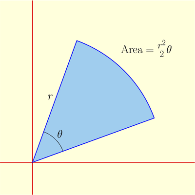

## Finding the Area Bounded by a Polar Curve

* Area enclosed by a polar curve:

 The area enclosed by a polar curve can be thought of similar to the sector area of a circle. Think of it as the summation of the areas of smaller sectors with a small angle $\Delta \theta$.

* To find the area between angles $a$ and $b$, we use:

$$
\int_{b}^{a}{\frac{1}{2}r^{2}}\text{dθ}
$$

* To find the area between 2 polar curves, $r_1$ and $r_2$, find their points of **intersection** and use the formula:

$$

\frac{1}{2}\int_{b}^{a} r^2_1 - r^2_2
$$

* To find the area using a **cartesian equation**:
  * Convert your polar curve equation to a cartesian curve equation, and then convert the limits to cartesian coordinates to integrate normally.

    
OR

  * For simple polar curves: If given an integral in the form of a cartesian equation, find the area of the triangle with the base as the limits of the integral $x = a$ to b. Subtract this area from the area covered by the polar curve.

