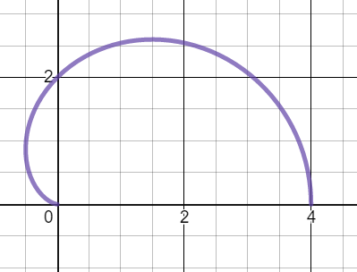
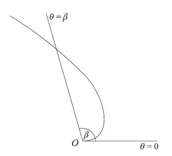

## Solved questions

{SP20-P01} Question 3

The curve $C$ has a polar equation $r = 2 + 2\cos\theta$,
for $0\  \leq \theta \leq \pi$

a)  Sketch $C$

b)  Find the area of the region enclosed by $C$ and the initial
line\*\*

c)  Show that the Cartesian equation of $C$ can be expressed
as
$4\left( x^{2} + y^{2} \right) = \left( x^{2} + y^{2} - 2x \right)^{2}$

**
Solution:
**

We can refer to Section 3.3 for sketching cardioids to help us draw.

*Sketching C, we get:*

 

*(Ans for a)*

*Use the formula to find area of a Polar Curve:*

$$
\int_{0}^{\pi}\frac{1}{2}\left( 2 + 2\cos\theta \right)^{2}\text{ d}\theta
$$

$$
\rightarrow \int_{0}^{\pi}{\frac{1}{2}\left( 4 + 8\cos\theta + 4\cos^{2}\theta \right)}\text{\ d}\theta
$$

$$
\rightarrow \int_{0}^{\pi}\left( 2 + 4\cos\theta + 2\cos^{2}\theta \right)\text{\  d}\theta
$$

*Use the double-angle formula:*

$$
\rightarrow \int_{0}^{\pi}2 + 4\cos\theta + 1 + \cos{2\theta}d\theta
$$

$$
\rightarrow \left\lbrack 3\theta + 4\sin\theta + \frac{1}{2}\sin{2\theta} \right\rbrack_{0}^{\pi}
$$

$$
\rightarrow 3\pi + 4\sin\pi + \frac{1}{2}\sin{2\pi} = 3\pi\quad\mathrm{(Ans\ for\ b)}
$$

*Using the formula shown in Section 3.2, let*
$r^{2} = x^{2} + y^{2},\ \ x = r\cos\theta$\* and *$y = r\sin\theta$*.\*

$$
r = 2 + 2\cos\theta
$$

$$
\rightarrow \sqrt{x^{2} + y^{2}} = 2 + 2 \times \frac{x}{\sqrt{x^{2} + y^{2}}}
$$

$$
\rightarrow x^{2} + y^{2} = 2\sqrt{x^{2} + y^{2}} + 2x
$$

$$
\rightarrow 2\sqrt{x^{2} + y^{2}} = x^{2} + y^{2} - 2x
$$

*Squaring both sides:*

$$
4\left( x^{2} + y^{2} \right) = \left( x^{2} + y^{2} - 2x \right)^{2}\quad\mathrm{(Ans\ for\ c)}
$$

---

**{S03-P01} Question 1:**

 

The curve $C$ has polar equation

$$
r = \theta^{\frac{1}{2}}e^{\frac{\theta^{2}}{\pi}}
$$

where $0\leq\theta\leq\pi$. The area of the
finite region bounded by $\mathbf{C}$ and the line
$\mathbf{\theta=\beta}$ is $\mathbf{\pi}$. Show that

$$
\beta = \left( \pi\ln 3 \right)^{\frac{1}{2}}
$$

**
Solution:
**

*Form an equation by using the area of sector formula*

$$
\int_{}^{}{\frac{1}{2}r^{2}\theta}.\ d\theta = A
$$

$$
\int_{0}^{\beta}{\frac{1}{2}\left( \theta^{\frac{1}{2}}e^{\frac{\theta^{2}}{\pi}} \right)^{2}\theta} = \pi
$$

*Take ½ to the other side and clean up*

$$
\int_{0}^{\beta}{\theta e^{\frac{2\theta^{2}}{\pi}}} = 2\pi
$$

*Integrate the expression with respect to* $\theta$

$$
\left\lbrack \frac{\pi}{4}e^{\frac{2\theta^{2}}{\pi}} \right\rbrack_{0}^{\beta} = 2\pi
$$

*Take constant to other side and substitute* $\beta$ *and 0*

$$
e^{\frac{2\beta^{2}}{\pi}} - 1 = 8
$$

$$
e^{\frac{2\beta^{2}}{\pi}} = 9
$$

*Take* $\ln\text{e }$*on both sides and simplify*

$$
\frac{2\beta^{2}}{\pi} = \ln 9
$$

$$
\beta^{2} = \pi\ln 3
$$

$$
\therefore\beta = \left( \pi\ln 3 \right)^{\frac{1}{2}}
$$

