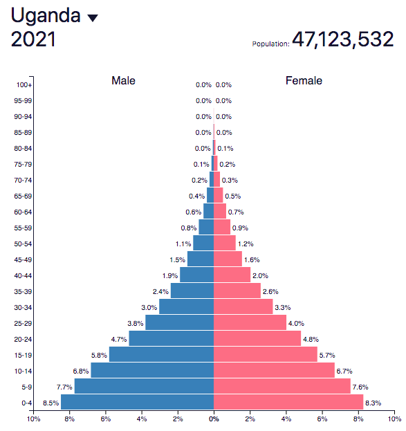

# Youthful Country Issues

## Uganda

**Background stats**

* Life Expectancy is 63
* By 2050 it is predicted to become the 6th most populous country in Africa
* In early stage-2 of the DTM
* The mean age of birth for mothers is 19
* 25% urban population
* Population density will increase from 122 inhabitants per km² to 551 per km² in 2050

  \
   

**Problems**

* Civil war
  * Countries with a very youthful population are statistically more likely to experience civil conflicts/outbreaks
  * 1970-2007→ 80% of new civil conflicts occurred in countries with autocratic or partially democratic governments
* The demand for environmental resources
  * Increased land fragmentation and a decrease in soil fertility causes crop yields to fall
  * Depletion of wetlands to expand agricultural lands and deforestation to gain firewood used as fuel
* Rural-urban migration
  * Annual urban growth is 5.2% (the highest in the world)
    * 53 million living in urban areas
    * 51 million in rural areas
  * 60% of Uganda lives in slums + mobility of goods is restrained due to heavy congestion in cities
  * Youth migrate to urban areas for:
    * Lack of economic options in rural areas (better opportunities in urban areas to possibly lift them out of poverty)
    * Inadequate land access
    * Family access
* Housing
  * 24 million housing deficit
  * Lack of sewage system
  * Overcrowding + slum growth + deterioration
    * Very few people have access to electricity + safe drinking water
* Employment issues
  * High youthful population
  * Not enough money for education
* Poverty
  * 35.9% live on the poorest wealth
  * The majority of people rely on subsistence + don’t have enough money for education
  * 1/3 population lacks basic purchasing power (can’t afford key essential goods such as food and water)
  * Even if fertility rates dropped massively (below replacement level), Uganda’s population would continue to grow for 40-50 years due to the level of population momentum the nation has
* Poor education
  * High costs needed to fund education
  * Education is rigid + highly disorganized
  * Don’t know about family planning
  * A high ratio of teacher: students of 1:50
  * 1/4 don’t reach the end of primary school
  * 83% of 10 years old don’t read the text at the end of primary school
* Poor nutrition
  * Bottle necking access especially between urban + rural areas due to war
    * Majority unable to afford agricultural inputs
    * Can’t optimize land properly to plant crops
    * Low yields as a result
  * 16700 children die per year
  * Women worn out from birthing + have higher costs with more kids + resources stretched thinly
  * Can’t access agricultural inputs to optimize their farm or afford HYV/GMO for larger families
  * 29% of children experience stunted growth and development (both physical and/or cognitive)
  * 167,000 children under 5 years old die each year
* High Infant Mortality Rate
  * Poor healthcare and nutrition
  * In childhood prone to communicable diseases such as tuberculosis, diarrhoea, or cholera, all of which stem largely from poor hygiene and sanitation

**Solutions**

* Better family planning
  * Women have the right to decide the number of children they want
  * Lowered fertility and increased contributions to the economy by females can improve Uganda’s potential for a demographic dividend
  * Better access to contraception
    * 40% of people don’t use contraception
    * The northern region had 55% compared to the central region with 35%
* Education
  * Women with a secondary education marry 3-4 years later than women with no education
  * Age at first birth greatly affects final family size (younger marriages usually result in more children and vice versa)
* Family planning services
  * Reduce fertility levels and increase the proportion of adults: economic age group
* Government incentives
  * Promote parenthood and limit subsidies to the first 2 children
  * Educating people on contraception can reduce issues associated with overpopulation in Uganda

