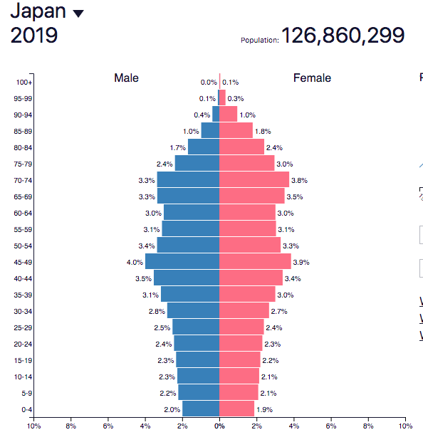

# Ageing population issues

## Japan

Background information:

* Stage 5 of the DTM
* 86 is the life expectancy
* 28% are 65 years
* 13% under 15
* 70/1000 total dependency ratio
* 1.4 FR, BR-7.1, DR 10
  * -3% growth rate

 

**Burdens of the ageing population**

* Shrinking of the working population
  * Fewer children born, more people enter retirement age
* Dwindling workforce detracts from economic growth and impacts financial markets via reduced savings + investment levels
  * Decline in quality of goods + services
  * Remaining working population has to bear the brunt of caring for ageing population (10% of income taken up by tax for old age which is 2x 2020)
* Labour forces shortages are associated with ageing
  * Greater caregiving needs for ill
  * Adults are more likely to require additional medication
* Healthcare cost containment with a high amount of GDP
  * Wrapped up in health spending (10.7% in 2017 + sixth highest share among all countries)
  * Social security take up 33.3% Japan in FY2017 + nearly double FY1990 share of 17.5%
* Benefit payments grow at a faster rate
  * Expanding gap between insurance costs + revenue
  * Makes it harder for govt to meet pension obligations to elderly

**Solutions**

* New Angel Plan (1999)
  * Housing children is easier
* Abenomics
  * Increase the size of the workforce by incentivising the female labour force
* Raise ages for retirement + pensions eligibility
  * Slowly raising pension eligibility from 60 to 65 by 2025 for men and 2030 for women
* Promote healthier lifestyles
  * People can work longer and can lead to higher productivity and labour force participation
  * Higher saving rates, lower medical expenses and increased foreign direct investment
  * Can help with reducing medical expenses for elderly (improved diets, active lifestyles, reduced tobacco, vaccination and unsafe alcohol consumption)

